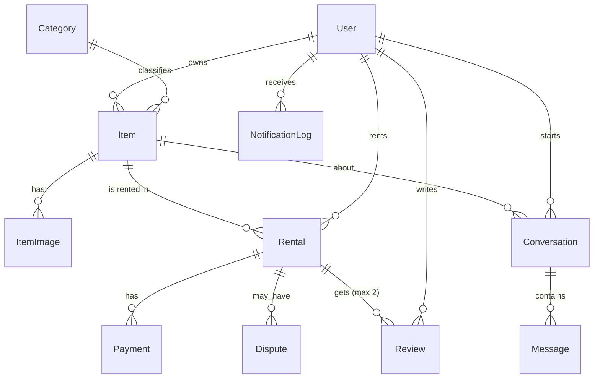

# DOMAIN — models and relations (source of truth)
Money = DecimalField(max_digits=12, decimal_places=0). All models have `created_at` (auto_now_add) unless noted.

## accounts
**User** (extends AbstractUser; `AUTH_USER_MODEL = "accounts.User"` — set BEFORE the first migrate)
- email (unique, required), phone (blank), city, neighborhood, bio (blank), is_email_verified (bool, default False)
- Admin = `is_staff`. No separate role field.

## catalog
**Category**: name, slug (unique), parent (FK self, null)
**Item**: owner (FK User, related_name="items"), category (FK PROTECT), title, description, brand (blank), condition (new / like_new / good / fair), hourly_price (null), daily_price, deposit_amount (default 0), city, neighborhood, allow_pickup (bool), allow_courier (bool), is_active (bool), updated_at, latitude (Decimal 9,6, null), longitude (Decimal 9,6, null), address_text (CharField 255, blank) = pickup point
- CheckConstraint daily_price > 0; CheckConstraint allow_pickup OR allow_courier; Index (city, is_active); CheckConstraint "latitude and longitude are both null or both set"; validators latitude −90..90, longitude −180..180.
**ItemImage**: item (FK, related_name="images"), image (ImageField), is_primary (bool), order (int)

## rentals
**Rental**: item (FK PROTECT), renter (FK User PROTECT, related_name="rentals"), start_at, end_at, delivery_method (pickup / courier), status, rent_amount, deposit_amount, commission_rate (Decimal 0.15), commission_amount, owner_payout, tracking_code (unique, null), updated_at, delivery_address (TextField, blank; the form requires it when delivery_method = courier), delivery_latitude, delivery_longitude (Decimal 9,6, null, both-or-none constraint), reminder_sent_at (DateTimeField, null)
- CheckConstraint end_at > start_at. Rule in clean(): renter != item.owner; no overlap with another non-cancelled rental of the same item.
- Status: `pending_payment → confirmed → handed_over → returned → completed`; side exits: `cancelled` (from pending_payment/confirmed), `disputed` (from handed_over/returned).
- Pricing (services.py): duration < 24h and hourly_price set → ceil(hours) × hourly_price; else ceil(days) × daily_price. commission = rent × rate; owner_payout = rent − commission.
**Payment** (simulated): rental (FK), kind (rent / deposit / deposit_refund / payout), amount, status (success / failed), receipt_no (unique)
**Dispute**: rental (FK), opened_by (FK User), reason, status (open / resolved), deposit_decision (return_to_renter / give_to_owner / split; blank until resolved), resolution_note, resolved_by (FK User, null), resolved_at (null)

## reviews
**Review**: rental (FK), reviewer (FK User), reviewee (FK User), reviewee_role (owner / renter), rating (1–5, CheckConstraint), comment (blank)
- UniqueConstraint (rental, reviewer): each side reviews once per rental. Allowed only when rental.status == completed.

## chat
**Conversation**: item (FK), renter (FK User), updated_at; UniqueConstraint (item, renter). Owner = item.owner.
**Message**: conversation (FK), sender (FK User), body, is_read (bool)

## core
**NotificationLog**: user (FK User, null, SET_NULL), channel (email / sms), event (signup_confirmation / item_registered / rental_ending_soon), recipient (CharField), subject (blank), body (TextField), status (sent / failed / skipped), error (blank), item (FK null), rental (FK null), created_at. Index (event, created_at).
Core also holds: notifications.py, sms.py, middleware (request logging), cookie helpers, error views.

## ER (mermaid)

