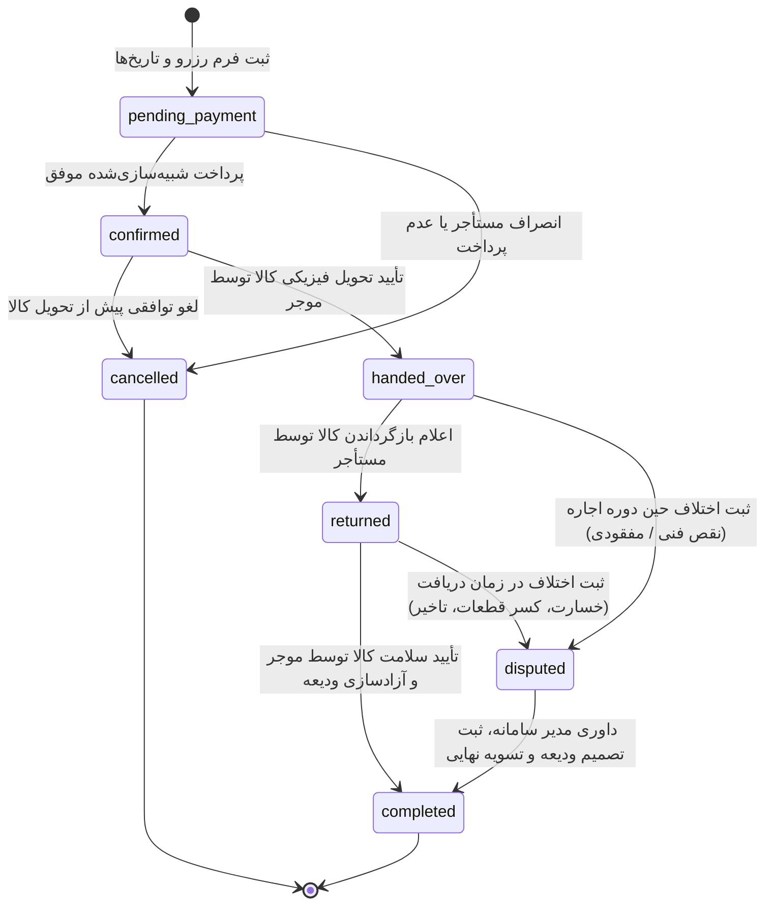
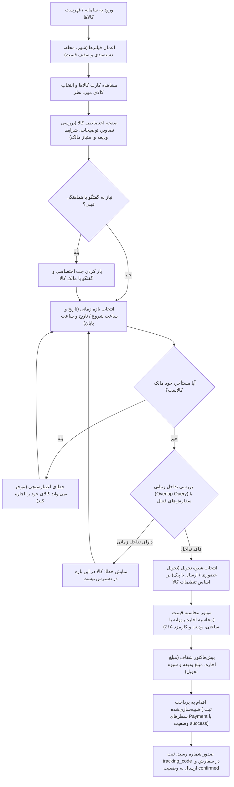
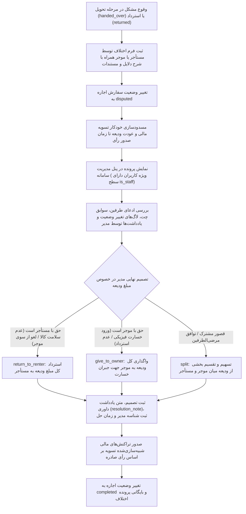

# PROCESSES — فرآیندهای کسب‌وکار و نمودارهای سامانه امانت‌یاب

این مستند فرآیندهای عملیاتی، جریان داده و ماشین وضعیت سیستم امانت‌سپاری محله‌محور «امانت‌یاب» را تشریح می‌کند. تمامی نمودارها با استاندارد Mermaid پیاده‌سازی شده و مستقیماً در مخزن GitHub قابل مشاهده و رندر هستند.

---

## ۱. فرآیند کلی وب‌سایت (Whole Website Process)
این نمودار، سفر کاربر (User Journey) را از لحظه ورود به عنوان بازدیدکننده مهمان، ثبت‌نام و ورود، تا مشاهده، هماهنگی، اجاره کالا، تحویل و ثبت بازخورد، و همچنین مسیر حل اختلاف نشان می‌دهد.

```mermaid
flowchart TD
  Guest["بازدیدکننده / مهمان"] --> AuthCheck{"آیا حساب کاربری دارد؟"}
  AuthCheck -- "خیر" --> SignUp["ثبت‌نام کاربر (نام کاربری، ایمیل معتبر، رمز، شهر و محله)"]
  AuthCheck -- "بله" --> Login["ورود به حساب کاربری (نشست امن Django Session)"]
  SignUp --> Login
  
  Login --> Dashboard{"هدف کاربر چیست؟"}
  
  Dashboard -- "سپردن کالا (موجر)" --> ManageItems["مدیریت کالاهای من (ثبت، ویرایش، تصاویر، فعال/غیرفعال‌سازی)"]
  ManageItems --> CatalogLive["انتشار کالا در کاتالوگ محله"]
  
  Dashboard -- "اجاره کالا (مستأجر)" --> SearchCatalog["جستجو و فیلتر در کاتالوگ (دسته‌بندی، شهر، محله، قیمت)"]
  CatalogLive --> SearchCatalog
  
  SearchCatalog --> ItemDetail["مشاهده صفحه جزئیات کالا، تصاویر، ودیعه و امتیاز موجر"]
  ItemDetail --> ChatDecision{"نیاز به پرسش یا هماهنگی با موجر؟"}
  ChatDecision -- "بله" --> ChatSystem["ارسال پیام متنی در چت اختصاصی کالا"]
  ChatDecision -- "خیر" --> RentRequest["ثبت درخواست اجاره (انتخاب تاریخ شروع و پایان و نحوه تحویل)"]
  ChatSystem --> RentRequest
  
  RentRequest --> CostCalc["اعتبارسنجی تداخل زمانی و محاسبه هزینه اجاره، ودیعه و کارمزد"]
  CostCalc --> PaymentSim["پرداخت شبیه‌سازی‌شده (ثبت فاکتور در جدول Payment)"]
  PaymentSim --> RentalConfirmed["تأیید اجاره و صدور کد رهگیری یکتا (وضعیت: confirmed)"]
  
  RentalConfirmed --> Handover["تحویل فیزیکی کالا (حضوری / پیک) و تأیید موجر (وضعیت: handed_over)"]
  Handover --> InUse["استفاده در بازه زمانی توافق‌شده"]
  InUse --> ReturnItem["بازگرداندن کالا توسط مستأجر (وضعیت: returned)"]
  
  ReturnItem --> Inspection{"آیا کالا بدون آسیب و بموقع بازگشت؟"}
  Inspection -- "بله (تأیید سلامت کالا توسط موجر)" --> RentalCompleted["تکمیل فرآیند و آزادسازی ودیعه (وضعیت: completed)"]
  RentalCompleted --> TwoWayReview["ثبت امتیاز و دیدگاه دوطرفه (موجر و مستأجر نسبت به یکدیگر)"]
  
  InUse -. "بروز نقص، مفقودی یا عدم تحویل" .-> DisputeFlow["ثبت اختلاف توسط یکی از طرفین (وضعیت: disputed)"]
  Inspection -- "خیر (خسارت یا تاخیر)" --> DisputeFlow
  DisputeFlow --> AdminResolve["رسیدگی مدیر سامانه (is_staff)، تعیین وضعیت ودیعه و مختومه کردن"]
  AdminResolve --> RentalCompleted
```

---

## ۲. ماشین وضعیت چرخه اجاره (Rental State Machine)
چرخه عمر هر سفارش اجاره از لحظه ایجاد درخواست تا پایان، با رعایت دقیق شروط و محدودیت‌های مدل `Rental`، در قالب نمودار حالت زیر مدیریت می‌شود.

### شرح وضعیت‌های اجاره:
1. **`pending_payment`:** درخواست اجاره با تاریخ شروع و پایان انتخاب شده، اما هزینه و ودیعه هنوز واریز نشده است.
2. **`confirmed`:** پرداخت ودیعه و هزینه اجاره با موفقیت شبیه‌سازی شده و کالا برای مستأجر رزرو قطعی شده است (کد رهگیری صادر شده است).
3. **`handed_over`:** کالا در محل مشخص‌شده (حضوری یا پیک) به مستأجر تحویل داده شده و موجر این مرحله را در سامانه تأیید کرده است.
4. **`returned`:** مستأجر پس از پایان استفاده، کالا را پس فرستاده یا تحویل داده و وضعیت استرداد را اعلام نموده است.
5. **`completed`:** موجر سلامت کالا را تأیید کرده، ودیعه آزاد شده و فرآیند تسویه کامل شده است؛ در این وضعیت امکان ثبت دیدگاه و امتیاز دوطرفه فعال می‌شود.
6. **`cancelled`:** اجاره پیش از تحویل کالا (در حالت انتظار پرداخت یا تایید) توسط کاربر یا سیستم لغو شده است.
7. **`disputed`:** در صورت بروز اختلاف بر سر خسارت، عدم بازگشت کالا یا نقض توافق، پرونده قفل شده و به مدیر ارجاع می‌گردد.

---

## ۳. فرآیند جستجو تا ثبت و پرداخت اجاره (Search to Rent Flow)
این جریان نحوه فیلتر کردن کالاهای محله، بررسی عدم هم‌پوشانی تاریخ‌ها (Overlap Check)، محاسبه نرخ روزانه/ساعتی و کارمزد، و پرداخت شبیه‌سازی‌شده را به تصویر می‌کشد.

---

## ۴. فرآیند ثبت و رسیدگی به اختلاف (Dispute Resolution Flow)
در صورتی که کالا دچار آسیب‌دیدگی شود، به موقع مسترد نگردد، یا مغایر با مشخصات اعلامی باشد، فرآیند داوری شفاف توسط مدیر طبق نمودار زیر اجرا می‌گردد:

---

## ۵. خلاصه فرآیندهای به تفکیک اپلیکیشن‌های پروژه

- **`accounts`:** مدیریت چرخه ثبت‌نام کاربر با ایمیل یکتا، ورود امن با نشست جنگو، ویرایش اطلاعات محلی (شهر و محله) و تلفن، مدیریت نقش‌های سیستمی (تفکیک کاربر عادی و ادمین صرفاً با فلگ استاندارد `is_staff`).
- **`catalog`:** مدیریت دسته‌بندی‌های کاتالوگ با ساختار خودارجاعی (درخت دسته‌ها)، ایجاد و ویرایش کالاهای امانتی توسط مالکین با شرایط فیزیکی، قیمت‌گذاری روزانه/ساعتی و مبلغ ودیعه، مدیریت چند تصویر به ازای هر کالا با تعیین تصویر اصلی، و قابلیت تعلیق موقت آگهی (`is_active`).
- **`rentals`:** هسته مدیریت رزرو و چرخه عمر امانت، اعتبارسنجی قیود زمانی و عدم هم‌پوشانی رزروها (Double-booking prevention)، شبیه‌سازی پرداخت و ثبت تراکنش‌های واریز/استرداد ودیعه، پیگیری سفارش با کد رهگیری، و داوری پرونده‌های اختلاف.
- **`reviews`:** ثبت بازخورد و امتیاز ۱ تا ۵ ستاره به همراه متن نظر به صورت دوطرفه (موجر به مستأجر و بالعکس) منحصراً پس از اتمام موفقیت‌آمیز اجاره (`completed`)، با قید یکتایی مانع از ثبت مجدد نظر در هر معامله.
- **`chat`:** ایجاد گفتگوی دونفره بر بستر هر کالای کاتالوگ میان متقاضی اجاره و مالک آن، ثبت پیام‌ها با وضعیت خوانده‌شده، و تسهیل هماهنگی‌های محلی پیش و حین اجاره بدون نیاز به اشتراک اطلاعات تماس خصوصی.
- **`core`:** زیرساخت اشتراکی سامانه، ارائه‌دهنده قالب پایه (Base Layout) با استانداردهای RTL و فونت وزیرمتن، میدل‌ور ثبت لاگ درخواست‌ها، ابزارهای مدیریت کوکی و سشن، و صفحات خطای سفارشی ۴۰۴ و ۵۰۰.
