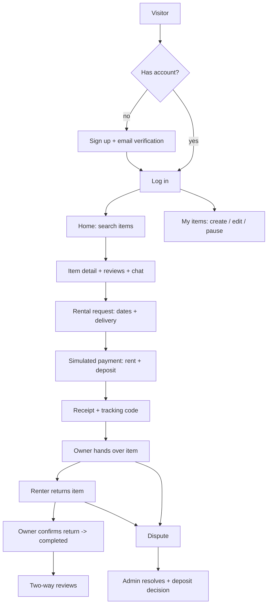
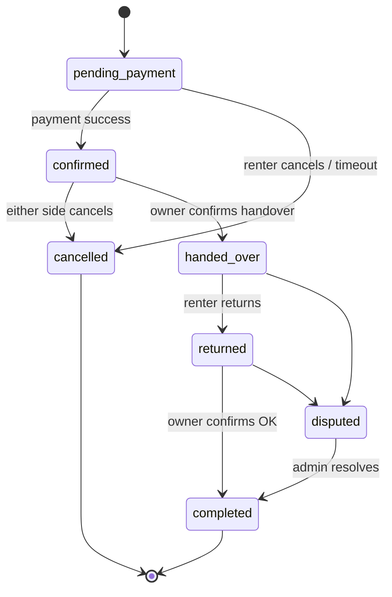

# PROCESSES — website process diagrams (draft; finalised in P1-03)
Persian labels are fine in the final version. Render with any mermaid viewer (GitHub renders them).

## 1. Whole website

## 2. Rental state machine

## 3. Per-app process description (to be written in Persian in P1-03 → REPORT.md §2)
- accounts: sign up, email verification (P4), login/logout, profile edit, public profile with rating.
- catalog: owner CRUD items + images, pause/activate, public list/search/filter, detail.
- rentals: request, cost calculation, overlap check, simulated payment, receipt, lifecycle actions, cancellation, dispute open/resolve.
- reviews: after completed rental both sides rate 1–5 + comment; averages on profiles and items.
- chat: renter asks owner questions from the item page (conversation per item+renter).
- core: base layout, logging middleware, cookies/session helpers, error pages.
