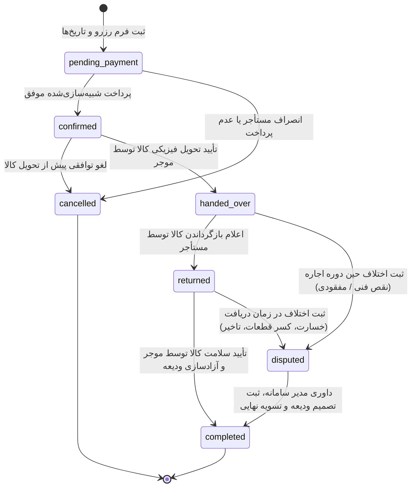
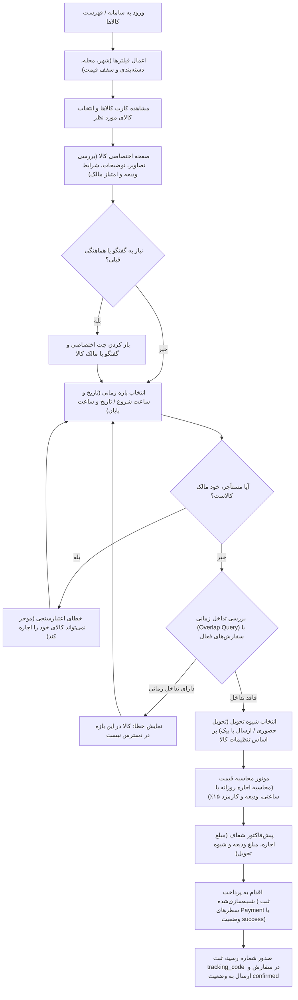
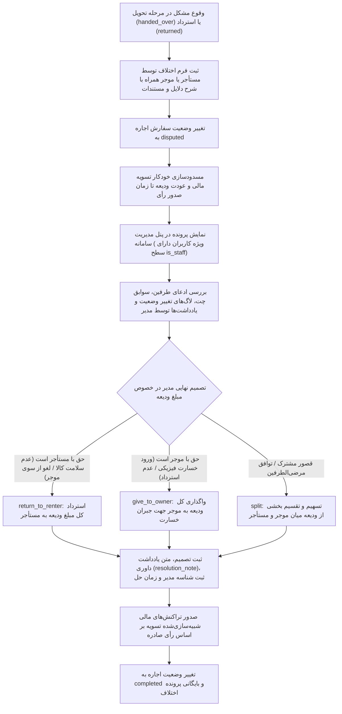

# گزارش پروژه — امانت‌یاب (درس برنامه‌نویسی وب)
نویسنده: امیر بازرگانی  |  استاد: سرکار خانم مهندس سلطانی  |  ترم: پاییز ۱۴۰۳

## ۱. نمودار فرآیندهای وب‌سایت
در سامانه «امانت‌یاب»، جریان کاربری، مدیریت وضعیت معاملات، فرآیند جستجو و رزرو، و حل اختلاف به صورت ماژولار و ساختاریافته طراحی شده‌اند. این فرآیندها در قالب ۴ نمودار استاندارد Mermaid مستند گردیده‌اند (جزئیات تکمیلی در سند `docs/PROCESSES.md` در دسترس است):

### ۱-۱. فرآیند کلی وب‌سایت (Whole Website Process)
این نمودار چرخه کامل تعامل کاربر مهمان و ثبت‌نام‌شده با سامانه، از جستجو یا ثبت کالا تا تحویل، پرداخت، ثبت نظر و داوری اختلافات را نشان می‌دهد:

```mermaid
flowchart TD
  Guest["بازدیدکننده / مهمان"] --> AuthCheck{"آیا حساب کاربری دارد؟"}
  AuthCheck -- "خیر" --> SignUp["ثبت‌نام کاربر (نام کاربری، ایمیل معتبر، رمز، شهر و محله)"]
  AuthCheck -- "بله" --> Login["ورود به حساب کاربری (نشست امن Django Session)"]
  SignUp --> Login
  
  Login --> Dashboard{"هدف کاربر چیست؟"}
  
  Dashboard -- "سپردن کالا (موجر)" --> ManageItems["مدیریت کالاهای من (ثبت، ویرایش، تصاویر، فعال/غیرفعال‌سازی)"]
  ManageItems --> CatalogLive["انتشار کالا در کاتالوگ محله"]
  
  Dashboard -- "اجاره کالا (مستأجر)" --> SearchCatalog["جستجو و فیلتر در کاتالوگ (دسته‌بندی، شهر، محله، قیمت)"]
  CatalogLive --> SearchCatalog
  
  SearchCatalog --> ItemDetail["مشاهده صفحه جزئیات کالا، تصاویر، ودیعه و امتیاز موجر"]
  ItemDetail --> ChatDecision{"نیاز به پرسش یا هماهنگی با موجر؟"}
  ChatDecision -- "بله" --> ChatSystem["ارسال پیام متنی در چت اختصاصی کالا"]
  ChatDecision -- "خیر" --> RentRequest["ثبت درخواست اجاره (انتخاب تاریخ شروع و پایان و نحوه تحویل)"]
  ChatSystem --> RentRequest
  
  RentRequest --> CostCalc["اعتبارسنجی تداخل زمانی و محاسبه هزینه اجاره، ودیعه و کارمزد"]
  CostCalc --> PaymentSim["پرداخت شبیه‌سازی‌شده (ثبت فاکتور در جدول Payment)"]
  PaymentSim --> RentalConfirmed["تأیید اجاره و صدور کد رهگیری یکتا (وضعیت: confirmed)"]
  
  RentalConfirmed --> Handover["تحویل فیزیکی کالا (حضوری / پیک) و تأیید موجر (وضعیت: handed_over)"]
  Handover --> InUse["استفاده در بازه زمانی توافق‌شده"]
  InUse --> ReturnItem["بازگرداندن کالا توسط مستأجر (وضعیت: returned)"]
  
  ReturnItem --> Inspection{"آیا کالا بدون آسیب و بموقع بازگشت؟"}
  Inspection -- "بله (تأیید سلامت کالا توسط موجر)" --> RentalCompleted["تکمیل فرآیند و آزادسازی ودیعه (وضعیت: completed)"]
  RentalCompleted --> TwoWayReview["ثبت امتیاز و دیدگاه دوطرفه (موجر و مستأجر نسبت به یکدیگر)"]
  
  InUse -. "بروز نقص، مفقودی یا عدم تحویل" .-> DisputeFlow["ثبت اختلاف توسط یکی از طرفین (وضعیت: disputed)"]
  Inspection -- "خیر (خسارت یا تاخیر)" --> DisputeFlow
  DisputeFlow --> AdminResolve["رسیدگی مدیر سامانه (is_staff)، تعیین وضعیت ودیعه و مختومه کردن"]
  AdminResolve --> RentalCompleted
```

### ۱-۲. ماشین وضعیت اجاره (Rental State Machine)
توالی و گذار وضعیت‌های هر سفارش اجاره در سامانه، به همراه نقاط انصراف و داوری، در نمودار حالت زیر مشخص شده است:

### ۱-۳. فرآیند جستجو تا ثبت و پرداخت اجاره (Search to Rent Flow)
مراحل یافتن کالا، بررسی شرایط دسترسی بدون تداخل با سایر رزروها، شیوه تحویل، برآورد هزینه و پرداخت:

### ۱-۴. فرآیند داوری و حل اختلاف (Dispute Resolution Flow)
نحوه مدیریت ادعاها، توقف تسویه مالی و تصمیم‌گیری مدیر در خصوص وجه امانی ودیعه:

---

## ۲. توضیح فرآیندها به تفکیک وب‌سایت و اپلیکیشن

### کل وب‌سایت
سامانه «امانت‌یاب» به عنوان یک پلتفرم اشتراک‌گذاری همتابه‌همتا (Peer-to-Peer) در مقیاس محله‌ای طراحی شده است تا امکان امانت‌سپاری و اجاره انواع ابزارآلات، تجهیزات، و لوازم خانگی را میان همسایگان فراهم آورد. در این پلتفرم، هر کاربر پس از ثبت‌نام می‌تواند به طور همزمان در هر دو نقش «موجر» (صاحب کالا) و «مستأجر» (امانت‌گیرنده) فعالیت نماید. جریان عملیاتی کل وب‌سایت با محوریت دسترسی سریع محلی، بهینه‌سازی هزینه‌ها و ایجاد اعتماد متقابل از طریق سیستم امانی وجه ضمانت (ودیعه)، بازخورد دوطرفه، و ارتباط مستقیم درون‌برنامه‌ای شکل گرفته است. هسته سیستم با تفکیک دقیق دامنه‌ها به ۶ اپلیکیشن مستقل جنگو سازمان‌دهی شده که هماهنگی میان آن‌ها، چرخه شفافی از کشف کالا تا تحویل، استرداد، و تسویه مالی امن را تضمین می‌کند.

### accounts
اپلیکیشن `accounts` مسئولیت چرخه حیات کاربران، هویت‌سنجی و مدیریت اطلاعات هویتی و سکونتی را بر عهده دارد. فرآیند این اپلیکیشن با ثبت‌نام کاربر از طریق فیلدهای نام کاربری یکتا، پست الکترونیکی معتبر و رمز عبور رمزنگاری‌شده آغاز می‌شود. کاربر در پروفایل خود مشخصات مهمی چون شماره تلفن، شهر، محله، و متن معرفی کوتاه (بیوگرافی) را تعیین می‌نماید که ستون فقرات فیلترهای محلی سامانه به شمار می‌رود. طبق اصل سادگی و استاندارد پروژه، نقش‌ها تفکیک پیچیده ندارند؛ تمام کاربران با یک مدل یکپارچه `User` فعالیت می‌کنند و تنها مدیران سامانه از طریق صفت `is_staff = True` متمایز می‌گردند. نشست‌ها با مکانیزم استاندارد کوکی و سشن جنگو امن‌سازی شده و فرآیند خروج و ویرایش مشخصات فردی به سادگی قابل مدیریت است.

### catalog
اپلیکیشن `catalog` ستون ویترین کالاها و مدیریت آگهی‌های امانی است. فرآیندها در این اپ شامل دو بخش عمومی و مدیریتی است: در بخش عمومی، ساختار درختی دسته‌بندی‌ها (`Category`) امکان مرور چندسطحی کالاها را فراهم می‌سازد؛ کاربران می‌توانند با استفاده از فیلترهای شهری، محله‌ای، بازه قیمت، و نام دسته‌بندی به جستجوی ابزارهای مورد نیاز بپردازند. در بخش اختصاصی مالکان، کاربر موجر می‌تواند کالای خود (`Item`) را با مشخصاتی نظیر وضعیت کیفی (نو، در حد نو، خوب، کارکرده)، نرخ اجاره روزانه و ساعتی، مبلغ ودیعه، و روش‌های مجاز تحویل (حضوری یا پیک) تعریف کند. همچنین مدیریت چندین تصویر به ازای هر کالا با تعیین یک تصویر اصلی (`is_primary`) در مدل `ItemImage` پشتیبانی می‌شود و موجر می‌تواند با فلگ `is_active` آگهی خود را بدون حذف فیزیکی، به طور موقت تعلیق یا مجدداً فعال نماید.

### rentals
اپلیکیشن `rentals` هسته اصلی منطق تراکنشی و حقوقی سامانه امانت‌یاب است. فرآیند رزرو با انتخاب تاریخ شروع و پایان و تعیین شیوه تحویل آغاز می‌شود. در گام نخست، سیستم با اعتبارسنجی جامع در سطح متد `clean()`، عدم تعلق کالا به خود کاربر متقاضی و همچنین عدم تداخل بازه درخواستی با سایر سفارش‌های رزروشده فعال (Double-Booking Prevention) را به صورت سخت‌گیرانه بررسی می‌نماید. در گام بعد، موتور محاسبه قیمت، بر مبنای مدت‌زمان و نرخ‌های روزانه/ساعتی، هزینه خالص اجاره، مبلغ ودیعه، و کارمزد سامانه (۱۵٪) را محاسبه می‌کند. پس از تأیید پیش‌فاکتور، فرآیند پرداخت به شکل شبیه‌سازی‌شده (با ثبت رکوردهای `Payment`، شناسه رسید، و تخصیص کد رهگیری منحصربه‌فرد) اجرا می‌شود. پس از پرداخت، سفارش وارد چرخه کنترل وضعیت‌ها (`pending_payment` -> `confirmed` -> `handed_over` -> `returned` -> `completed`) می‌گردد. همچنین زیرفرآیند داوری و حل اختلاف (`Dispute`) در صورت بروز هرگونه مشکل یا خسارت، مبالغ را تا زمان رسیدگی مدیر سامانه مسدود نموده و عودت یا جبران خسارت از محل ودیعه را سامان می‌دهد.

### reviews
اپلیکیشن `reviews` وظیفه سنجش رضایت و اعتبارسنجی اجتماعی کاربران و کیفیت ابزارها را پوشش می‌دهد. فرآیند ثبت نظر تنها پس از خاتمه موفقیت‌آمیز چرخه اجاره (وضعیت `completed`) در دسترس قرار می‌گیرد. در این فرآیند، هر دو طرف معامله (موجر و مستأجر) می‌توانند یک بار و به طور متقابل به عملکرد طرف دیگر امتیاز (از ۱ تا ۵ ستاره با قید اعتبارسنجی `MinValueValidator` و `MaxValueValidator`) و نظر متنی بدهند. قید یکتایی مرکب `(rental, reviewer)` در لایه پایگاه داده مانع از هرگونه ثبت نظر تکراری یا دستکاری امتیازات می‌شود. برآیند این امتیازها در پروفایل عمومی کاربران و صفحه جزئیات کالاها نمایش داده شده و ضریب اعتماد محله‌ای را ارتقا می‌بخشد.

### chat
اپلیکیشن `chat` کانال ارتباطی مستقیم و محرمانه درون پلتفرم است که کاربران را از به‌اشتراک‌گذاری شماره تلفن یا ارتباط خارج از سامانه بی‌نیاز می‌سازد. فرآیند گفتگو منحصراً بر بستر یک کالای معین و میان متقاضی اجاره و مالک آن در قالب موجودیت `Conversation` تشکیل می‌شود؛ قید یکتایی مرکب `(item, renter)` تضمین می‌کند که به ازای هر متقاضی و کالا، تنها یک رشته گفتگوی مداوم شکل بگیرد. طرفین می‌توانند پیش از رزرو نهایی برای هماهنگی ساعت تحویل، تست سلامت دستگاه، یا لوازم جانبی پیام متنی (`Message`) ارسال نمایند. این بستر علاوه بر بهبود تجربه کاربری، به عنوان سابقه مستند ارتباطی در صورت بروز اختلافات در فرآیند داوری به کمک مدیران سامانه می‌آید.

### core
اپلیکیشن `core` به عنوان بستر مشترک فنی، شالوده زیرساختی تمامی بخش‌های پروژه را تأمین می‌کند. این اپلیکیشن فاقد مدل داده‌ای اختصاصی در پایگاه داده است و تمرکز آن بر ارائه زیرساخت‌های اشتراکی است: از جمله قالب اصلی وب‌سایت (`base.html`) با ساختار راست‌به‌چپ (RTL) و تایپوگرافی فارسی، میدل‌ورهای کاربردی نظیر میدل‌ور ثبت لاگ درخواست‌ها و زمان پاسخ‌دهی جهت نظارت بر کارایی سیستم، کانتکست پروسسورهای عمومی جهت ارسال داده‌های پایه به قالب‌ها، ابزارهای کمکی کار با کوکی‌ها و سشن‌ها، و کنترل‌کننده‌های صفحات خطای استاندارد (نظیر صفحات سفارشی خطای ۴۰۴ و ۵۰۰). وجود اپلیکیشن `core` تضمین می‌کند که کدهای زیرساختی در میان سایر اپلیکیشن‌ها تکرار نشده و اصول طراحی تمیز (DRY) در کل پروژه رعایت گردد.

---

## ۳. مدل‌ها و روابط بین آن‌ها
(جدول هر مدل: فیلدها، نوع، قیود + نمودار ER از docs/DOMAIN.md)

## ۴. Managerها و دلیل تعریف آن‌ها
| Manager/QuerySet | متد | کار | چرا تعریف شد |
|---|---|---|---|

## ۵. Viewهای تعریف‌شده
| اپ | View | URL | متد HTTP | دسترسی | Template |
|---|---|---|---|---|---|

## ۶. نکات تکمیلی (Session/Cookie، Logging، تأیید ایمیل، تست‌ها)
