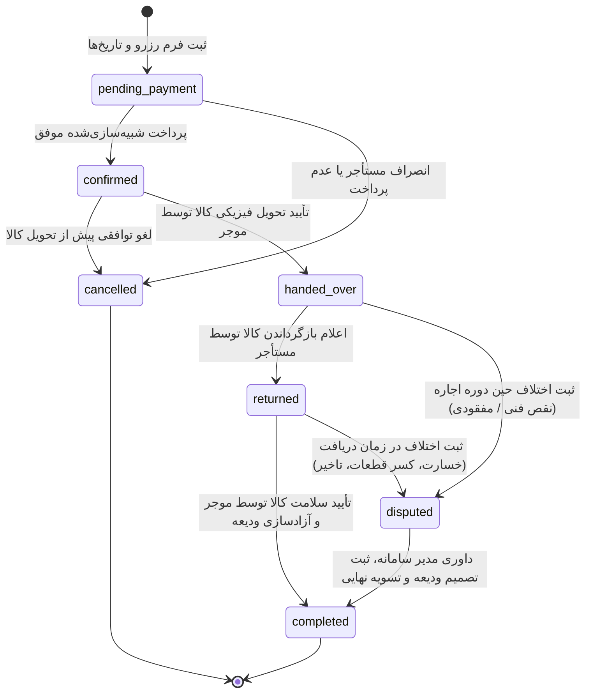
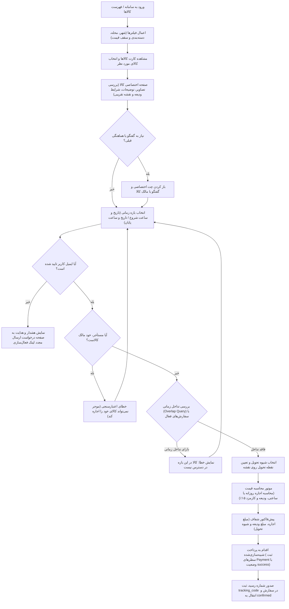
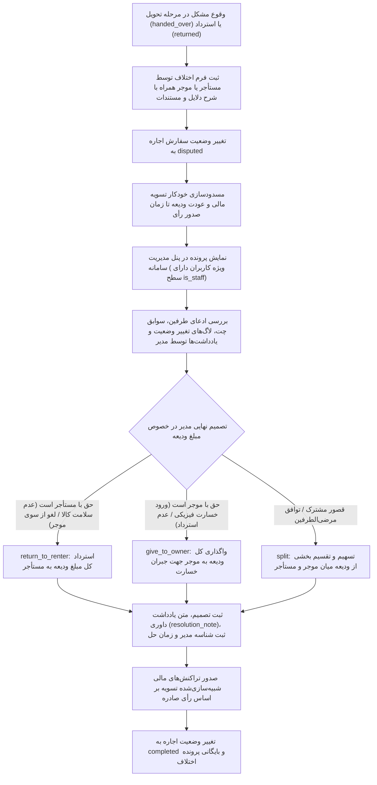
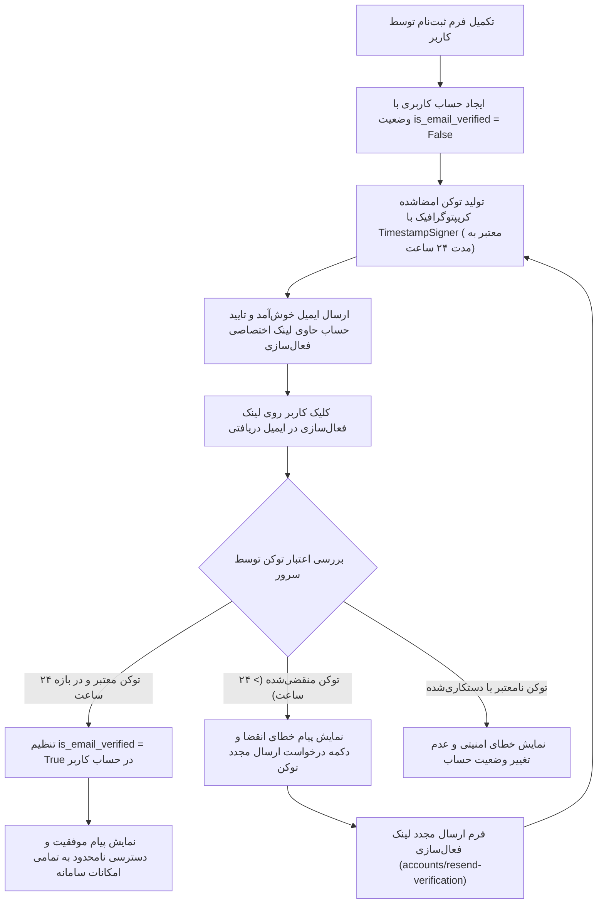
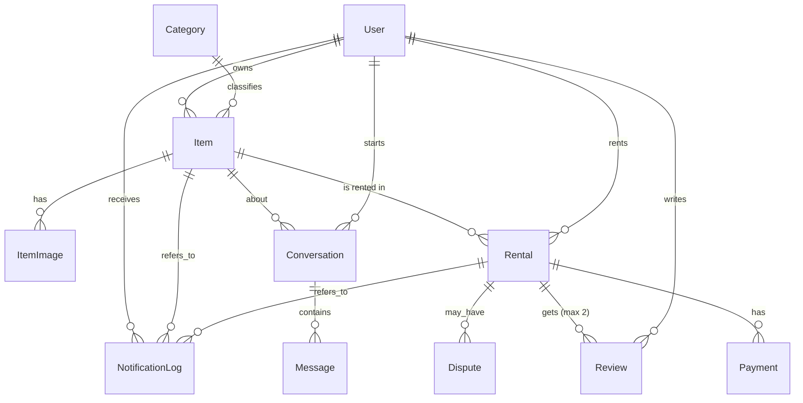

# گزارش پروژه — امانت‌یاب (درس برنامه‌نویسی وب)
نویسنده: امیر بازرگانی  |  استاد: سرکار خانم مهندس سلطانی  |  ترم: پاییز ۱۴۰۳

---

## ۱. نمودار فرآیندهای وب‌سایت
در سامانه «امانت‌یاب»، جریان کاربری، مدیریت چرخه وضعیت معاملات، فرآیند جستجو و رزرو، اعتبارسنجی هویت، و حل اختلاف به صورت ماژولار و ساختاریافته طراحی شده‌اند. این فرآیندها در قالب ۵ نمودار استاندارد Mermaid مستند گردیده‌اند (جزئیات تکمیلی در سند `docs/PROCESSES.md` در دسترس است):

### ۱-۱. فرآیند کلی وب‌سایت (Whole Website Process)
این نمودار چرخه کامل تعامل کاربر مهمان و ثبت‌نام‌شده با سامانه، از احراز هویت، جستجو یا ثبت کالا تا تحویل، پرداخت، ثبت نظر و داوری اختلافات را نشان می‌دهد:

```mermaid
flowchart TD
  Guest["بازدیدکننده / مهمان"] --> AuthCheck{"آیا حساب کاربری دارد؟"}
  AuthCheck -- "خیر" --> SignUp["ثبت‌نام کاربر (نام کاربری، ایمیل معتبر، رمز، شهر و محله)"]
  AuthCheck -- "بله" --> Login["ورود به حساب کاربری (نشست امن Django Session)"]
  SignUp --> VerifyEmailAction["ارسال ایمیل حاوی لینک فعال‌سازی ۲۴ ساعته (TimestampSigner)"]
  VerifyEmailAction --> Login
  
  Login --> EmailStatusCheck{"آیا ایمیل کاربر تایید شده است؟"}
  EmailStatusCheck -- "خیر (کاربر تاییدنشده)" --> RestrictedAccess["امکان مرور کاتالوگ و ورود؛ محدودیت در ثبت کالا، رزرو و چت (verified_required)"]
  EmailStatusCheck -- "بله (کاربر تاییدشده)" --> FullAccess["دسترسی کامل به تمامی قابلیت‌های تعاملی و معاملاتی"]
  
  FullAccess --> Dashboard{"هدف کاربر چیست؟"}
  
  Dashboard -- "سپردن کالا (موجر)" --> ManageItems["مدیریت کالاهای من (ثبت، ویرایش، تصاویر بهینه، موقعیت نقشه)"]
  ManageItems --> CatalogLive["انتشار کالا در کاتالوگ محله"]
  
  Dashboard -- "اجاره کالا (مستأجر)" --> SearchCatalog["جستجو و فیلتر در کاتالوگ (دسته‌بندی، شهر، محله، سقف قیمت)"]
  CatalogLive --> SearchCatalog
  
  SearchCatalog --> ItemDetail["مشاهده صفحه جزئیات کالا، تصاویر بهینه، ودیعه، موقعیت تقریبی و امتیاز موجر"]
  ItemDetail --> ChatDecision{"نیاز به پرسش یا هماهنگی با موجر؟"}
  ChatDecision -- "بله" --> ChatSystem["ارسال پیام متنی در چت اختصاصی کالا"]
  ChatDecision -- "خیر" --> RentRequest["ثبت درخواست اجاره (انتخاب تاریخ‌ها، شیوه تحویل و نشانی تحویل)"]
  ChatSystem --> RentRequest
  
  RentRequest --> CostCalc["اعتبارسنجی تداخل زمانی (Overlap) و محاسبه اجاره، ودیعه و کارمزد ۱۵٪"]
  CostCalc --> PaymentSim["پرداخت شبیه‌سازی‌شده (ثبت فاکتور در جدول Payment)"]
  PaymentSim --> RentalConfirmed["تأیید اجاره و صدور کد رهگیری یکتا (وضعیت: confirmed)"]
  
  RentalConfirmed --> Handover["تحویل فیزیکی کالا (حضوری / پیک) و تأیید موجر (وضعیت: handed_over)"]
  Handover --> InUse["استفاده در بازه زمانی توافق‌شده (ارسال پیامک/ایمیل یادآوری پایان موعد)"]
  InUse --> ReturnItem["بازگرداندن کالا توسط مستأجر (وضعیت: returned)"]
  
  ReturnItem --> Inspection{"آیا کالا بدون آسیب و بموقع بازگشت؟"}
  Inspection -- "بله (تأیید سلامت کالا توسط موجر)" --> RentalCompleted["تکمیل فرآیند و آزادسازی ودیعه (وضعیت: completed)"]
  RentalCompleted --> TwoWayReview["ثبت امتیاز و دیدگاه دوطرفه (موجر و مستأجر نسبت به یکدیگر)"]
  
  InUse -. "بروز نقص، مفقودی یا عدم تحویل" .-> DisputeFlow["ثبت اختلاف توسط یکی از طرفین (وضعیت: disputed)"]
  Inspection -- "خیر (خسارت یا تاخیر)" --> DisputeFlow
  DisputeFlow --> AdminResolve["رسیدگی مدیر سامانه (is_staff)، تعیین وضعیت ودیعه و مختومه کردن"]
  AdminResolve --> RentalCompleted
```



### ۱-۲. ماشین وضعیت اجاره (Rental State Machine)
توالی و گذار وضعیت‌های هر سفارش اجاره در سامانه، به همراه نقاط انصراف و داوری، در نمودار حالت زیر مشخص شده است:



### ۱-۳. فرآیند جستجو تا ثبت و پرداخت اجاره (Search to Rent Flow)
مراحل یافتن کالا، بررسی شرایط دسترسی بدون تداخل با سایر رزروها، شیوه تحویل، برآورد هزینه و پرداخت:



### ۱-۴. فرآیند داوری و حل اختلاف (Dispute Resolution Flow)
نحوه مدیریت ادعاها، توقف تسویه مالی و تصمیم‌گیری مدیر در خصوص وجه امانی ودیعه:



### ۱-۵. فرآیند تایید ایمیل و فعال‌سازی حساب کاربری (Email Verification Flow)
توالی امن تایید پست الکترونیکی با بهره‌گیری از توکن‌های امضاشده زمان‌دار:



---

## ۲. توضیح فرآیندها به تفکیک وب‌سایت و اپلیکیشن

### کل وب‌سایت
سامانه «امانت‌یاب» به عنوان یک پلتفرم اشتراک‌گذاری همتابه‌همتا (Peer-to-Peer) در مقیاس محله‌ای طراحی شده است تا امکان امانت‌سپاری و اجاره انواع ابزارآلات، تجهیزات، و لوازم خانگی را میان همسایگان فراهم آورد. در این پلتفرم، هر کاربر پس از ثبت‌نام می‌تواند به طور همزمان در هر دو نقش «موجر» (صاحب کالا) و «مستأجر» (امانت‌گیرنده) فعالیت نماید. جریان عملیاتی کل وب‌سایت با محوریت دسترسی سریع محلی، بهینه‌سازی هزینه‌ها و ایجاد اعتماد متقابل از طریق سیستم امانی وجه ضمانت (ودیعه)، بازخورد دوطرفه، احراز ایمیلی هویت و ارتباط مستقیم درون‌برنامه‌ای شکل گرفته است. هسته سیستم با تفکیک دقیق دامنه‌ها به ۶ اپلیکیشن مستقل جنگو سازمان‌دهی شده که هماهنگی میان آن‌ها، چرخه شفافی از کشف کالا تا تحویل، استرداد، و تسویه مالی امن را تضمین می‌کند.

### accounts
اپلیکیشن `accounts` مسئولیت چرخه حیات کاربران، هویت‌سنجی و مدیریت اطلاعات هویتی و سکونتی را بر عهده دارد. فرآیند این اپلیکیشن با ثبت‌نام کاربر از طریق فیلدهای نام کاربری یکتا، پست الکترونیکی معتبر و رمز عبور رمزنگاری‌شده آغاز می‌شود. کاربر در پروفایل خود مشخصات مهمی چون شماره تلفن، شهر، محله، و متن معرفی کوتاه (بیوگرافی) را تعیین می‌نماید که ستون فقرات فیلترهای محلی سامانه به شمار می‌رود. 
- **تایید ایمیل (Email Verification):** در فاز ۴، سیستم تایید ایمیل به کمک `django.core.signing.TimestampSigner` پیاده‌سازی شده است. هنگام ثبت‌نام، لینک فعال‌سازی معتبر به مدت ۲۴ ساعت برای کاربر ایمیل می‌شود. کاربران تایید‌نشده (`is_email_verified = False`) می‌توانند وارد سامانه شده و به مرور کاتالوگ بپردازند، اما از طریق دکوراتور امنیتی `verified_required` از انجام اقدامات تعاملی و ثبت آگهی، رزرو کالا و ارسال پیام محروم هستند تا از فعالیت حساب‌های هرزنامه جلوگیری گردد.
- **سشن‌ها و مرا به خاطر بسپار:** نشست‌ها با مکانیزم استاندارد کوکی و سشن امن جنگو مدیریت شده و در فرم ورود چک‌باکس «مرا به خاطر بسپار» تعبیه شده است.

### catalog
اپلیکیشن `catalog` ستون ویترین کالاها و مدیریت آگهی‌های امانی است. فرآیندها در این اپ شامل دو بخش عمومی و مدیریتی است:
- **بخش عمومی:** ساختار درختی دسته‌بندی‌ها (`Category`) امکان مرور چندسطحی کالاها را فراهم می‌سازد؛ کاربران می‌توانند با فیلترهای شهری، محله‌ای، بازه قیمت، و جستجوی متنی به ابزارهای مورد نیاز دسترسی یابند.
- **بخش مالک و نقشه:** کاربر موجر می‌تواند کالای خود (`Item`) را با مشخصاتی نظیر وضعیت کیفی، نرخ اجاره روزانه و ساعتی، مبلغ ودیعه، روش‌های مجاز تحویل (حضوری یا پیک) و موقعیت مکانی روی نقشه تعاملی Leaflet (`latitude`, `longitude`, `address_text`) تعریف کند.
- **بهینه‌سازی تصاویر:** به ازای هر کالا چندین تصویر در مدل `ItemImage` پشتیبانی می‌شود. در فاز ۴، کلیه تصاویر بارگذاری‌شده توسط کتابخانه Pillow به صورت خودکار تغییر اندازه یافته و با ابعاد حداکثر ۱۲۰۰ پیکسل و کیفیت بهینه ذخیره می‌شوند.
- **حذف N+1 و پارشال‌ها:** تمامی ویوهای کاتالوگ با متدهای `select_related` و `prefetch_related` بهینه‌سازی شده و از کامپوننت‌های مشترک تمپلیت (`item_card.html`, `empty_state.html`) بهره می‌برند.

### rentals
اپلیکیشن `rentals` هسته اصلی منطق تراکنشی و حقوقی سامانه امانت‌یاب است. فرآیند رزرو با انتخاب تاریخ شروع و پایان، شیوه تحویل و موقعیت جغرافیایی تحویل آغاز می‌شود.
- **اعتبارسنجی تداخل زمانی (Double-Booking Prevention):** سیستم با اعتبارسنجی جامع در سطح متد `clean()` و کوئری‌ست `overlapping()`، عدم تعلق کالا به متقاضی و عدم همپوشانی بازه انتخابی با سفارش‌های فعال را به صورت قطعی تضمین می‌کند.
- **موتور محاسبه قیمت و پرداخت:** بر مبنای مدت‌زمان و نرخ‌های روزانه/ساعتی، هزینه خالص اجاره، مبلغ ودیعه و کارمزد سامانه (۱۵٪) محاسبه می‌شود. پس از پرداخت شبیه‌سازی‌شده (`Payment`)، کد رهگیری یکتا صادر و وضعیت به `confirmed` منتقل می‌گردد.
- **چرخه وضعیت و یادآوری:** سفارش مراحل تحویل فیزیکی (`handed_over`)، بازگرداندن (`returned`) و تسویه نهایی (`completed`) را طی می‌کند. دستور پس‌زمینه `send_rental_reminders` با فیلد `reminder_sent_at` نزدیک شدن به پایان موعد اجاره را از طریق پیامک و ایمیل یادآوری می‌کند.
- **داوری و حل اختلاف (`Dispute`):** در صورت بروز خسارت یا تاخیر، وجوه امانی مسدود شده و مدیر سیستم با دسترسی `is_staff` اقدام به صدور رای عودت، خسارت یا تسهیم ودیعه می‌نماید.

### reviews
اپلیکیشن `reviews` وظیفه سنجش رضایت و اعتبارسنجی اجتماعی کاربران و کیفیت ابزارها را پوشش می‌دهد. 
- **امتیازدهی متقابل دوطرفه:** فرآیند ثبت نظر تنها پس از خاتمه موفقیت‌آمیز چرخه اجاره (وضعیت `completed`) در دسترس قرار می‌گیرد. هر دو طرف معامله (موجر و مستأجر) می‌توانند یک بار و به طور متقابل به عملکرد طرف دیگر امتیاز (از ۱ تا ۵ ستاره با قید `MinValueValidator` و `MaxValueValidator`) و نظر متنی بدهند.
- **یکتایی و محاسبات ORM:** قید یکتایی مرکب `(rental, reviewer)` در لایه دیتابیس مانع از ثبت نظر تکراری می‌شود و میانگین امتیازات مستقیماً توسط `ReviewQuerySet.average_rating()` محاسبه و در کاتالوگ و پروفایل نمایش می‌یابد.

### chat
اپلیکیشن `chat` کانال ارتباطی مستقیم و محرمانه درون پلتفرم است که کاربران را از به‌اشتراک‌گذاری اطلاعات تماس خصوصی بی‌نیاز می‌سازد.
- **مکالمه کالا-محور:** گفتگو منحصراً بر بستر یک کالای معین و میان متقاضی اجاره و مالک آن در قالب موجودیت `Conversation` با قید یکتایی مرکب `(item, renter)` شکل می‌گیرد.
- **تبادل پیام و حریم خصوصی:** طرفین در قالب مدل `Message` پیام‌های متنی هماهنگی را ارسال می‌کنند. فیلد `is_read` وضعیت خوانده شدن پیام‌ها را مشخص می‌کند. به منظور حفظ حریم خصوصی، متن پیام‌ها هرگز در فایل‌های لاگ سرور ثبت نمی‌گردد.

### core
اپلیکیشن `core` به عنوان بستر مشترک فنی، شالوده زیرساختی تمامی بخش‌های پروژه را تأمین می‌کند:
- **قالب و کامپوننت‌های پایه:** ساختار راست‌به‌چپ (RTL)، تایپوگرافی فارسی، قالب پایه `base.html` با استایل‌های واکنش‌گرای Tailwind و پارشال‌های پرکاربرد فرم و کارت‌ها.
- **کوکی‌ها و سشن‌ها:** توابع کمکی امضای امن HMAC در `cookies.py` برای ذخیره کالاهای اخیراً مشاهده‌شده (`recent_items`) و شهر انتخابی (`last_city`) با رفع خطای کاراکترهای یونیکد فارسی.
- **میدل‌ور لاگینگ:** میدل‌ور `RequestLogMiddleware` جهت ثبت متد، آدرس، کاربر، مدت زمان پردازش (میلی‌ثانیه) و کد وضعیت HTTP.
- **سیستم اعلان‌ها و مدل داده‌ای `NotificationLog`:** موتور ارسال چندکاناله اعلان‌های ایمیلی و پیامکی و ثبت ممیزی تاریخچه رویدادهای ارسالی در جدول پایگاه داده‌ای `NotificationLog`.

---

## ۳. مدل‌ها و روابط بین آن‌ها

در سامانه «امانت‌یاب»، ساختار داده‌ها بر پایه اصول طراحی رابطه‌ای (Relational Database Design) و نرمال‌سازی مناسب جهت پلتفرم همتابه‌همتا پیاده‌سازی شده است. تمام مدل‌های سامانه از پایگاه داده قدرتمند PostgreSQL استفاده می‌کنند. مقادیر مالی با دقت صفر رقم اعشار و حداکثر ۱۲ رقم (`numeric(12, 0)`) مدل‌سازی شده‌اند و کلیه جداول دارای فیلد ره‌گیری زمانی درج (`created_at`) و در صورت نیاز آخرین به‌روزرسانی (`updated_at`) هستند.

### ۳-۱. نمودار موجودیت-رابطه (ER Diagram)

نمودار زیر پیوندها و ماهیت روابط میان ۱۱ مدل اصلی سامانه (شامل مدل پایگاه داده‌ای لاگ اعلان‌ها در `core`) را نمایش می‌دهد:



---

### ۳-۲. جداول مشخصات مدل‌ها به تفکیک اپلیکیشن

#### ۱. اپلیکیشن `accounts`

##### مدل `User`
مدل سفارشی کاربر که با ارث‌بری از `AbstractUser` توسعه یافته است. در سامانه نقش‌های صلب وجود ندارد و هر کاربر بر حسب کانتکست تراکنش می‌تواند موجر یا مستأجر باشد؛ کاربران دارای `is_staff=True` به عنوان مدیر سامانه در نظر گرفته می‌شوند.

| نام فیلد | نوع در جنگو | نوع در PostgreSQL | مشخصات و پیش‌فرض | توضیحات و قیود |
|---|---|---|---|---|
| `id` | `BigAutoField` | `bigint` | Primary Key, Auto-increment | شناسه یکتای کاربر در سیستم |
| `username` | `CharField(150)` | `varchar(150)` | `unique=True`, اجباری | نام کاربری یکتا برای احراز هویت |
| `first_name` | `CharField(150)` | `varchar(150)` | `blank=True` | نام کوچک کاربر |
| `last_name` | `CharField(150)` | `varchar(150)` | `blank=True` | نام خانوادگی کاربر |
| `email` | `EmailField(254)` | `varchar(254)` | `unique=True`, اجباری | پست الکترونیکی یکتا جهت اعتبارسنجی و بازیابی |
| `phone` | `CharField(20)` | `varchar(20)` | `blank=True` | شماره تماس کاربر برای هماهنگی و پیامک |
| `city` | `CharField(100)` | `varchar(100)` | `blank=True` | شهر محل سکونت کاربر (پایه فیلتر محلی) |
| `neighborhood` | `CharField(100)` | `varchar(100)` | `blank=True` | محله سکونت کاربر (پایه تطبیق همسایگی) |
| `bio` | `TextField` | `text` | `blank=True` | بیوگرافی و توضیحات معرفی کاربر |
| `is_email_verified` | `BooleanField` | `boolean` | `default=False` | پرچم تأیید ایمیل از طریق توکن فعال‌سازی ۲۴ ساعته |
| `is_staff` | `BooleanField` | `boolean` | `default=False` | دسترسی مدیریتی (پنل داوری و نظارت) |
| `is_active` | `BooleanField` | `boolean` | `default=True` | وضعیت فعال بودن حساب کاربری |
| `is_superuser` | `BooleanField` | `boolean` | `default=False` | مدیر ارشد با تمام دسترسی‌های سیستم |
| `date_joined` | `DateTimeField` | `timestamp with time zone` | `default=timezone.now` | زمان پیوستن کاربر به سامانه |
| `last_login` | `DateTimeField` | `timestamp with time zone` | `null=True`, اختیاری | آخرین زمان ورود به حساب کاربری |

---

#### ۲. اپلیکیشن `catalog`

##### مدل `Category`
دسته‌بندی درختی و سلسله‌مراتبی کالاها برای ساختاردهی به ویترین کاتالوگ.

| نام فیلد | نوع در جنگو | نوع در PostgreSQL | مشخصات و پیش‌فرض | توضیحات و قیود |
|---|---|---|---|---|
| `id` | `BigAutoField` | `bigint` | Primary Key, Auto-increment | شناسه دسته‌بندی |
| `name` | `CharField(100)` | `varchar(100)` | اجباری | عنوان دسته‌بندی (مانند ابزار برقی) |
| `slug` | `SlugField(120)` | `varchar(120)` | `unique=True`, `allow_unicode=True` | شناسه متنی سئو و آدرس یکتا (پشتیبانی یونیکد فارسی) |
| `parent` | `ForeignKey('self')` | `bigint` | `null=True`, `blank=True`, `on_delete=CASCADE` | ارجاع به والد برای درخت تودرتو (`related_name="children"`) |
| `created_at` | `DateTimeField` | `timestamp with time zone` | `auto_now_add=True` | زمان ثبت دسته‌بندی در سیستم |

- **ترتیب پیش‌فرض (`ordering`):** بر اساس `["name"]`.

##### مدل `Item`
کالای قابل امانت‌سپاری که توسط موجر به اشتراک گذاشته می‌شود.

| نام فیلد | نوع در جنگو | نوع در PostgreSQL | مشخصات و پیش‌فرض | توضیحات و قیود |
|---|---|---|---|---|
| `id` | `BigAutoField` | `bigint` | Primary Key, Auto-increment | شناسه یکتای کالا |
| `owner` | `ForeignKey(User)` | `bigint` | `on_delete=CASCADE` | مالک کالا (کاربر موجر) (`related_name="items"`) |
| `category` | `ForeignKey(Category)` | `bigint` | `on_delete=PROTECT` | دسته‌بندی کالا (حفاظت‌شده در برابر حذف دسته‌بندی) |
| `title` | `CharField(200)` | `varchar(200)` | اجباری | عنوان آگهی کالا |
| `description` | `TextField` | `text` | اجباری | توضیحات کامل وضعیت کالا و شرایط استفاده |
| `brand` | `CharField(100)` | `varchar(100)` | `blank=True` | برند یا سازنده کالا |
| `condition` | `CharField(20)` | `varchar(20)` | Choices (`new`, `like_new`, `good`, `fair`) | وضعیت کیفی و سلامت دستگاه |
| `hourly_price` | `DecimalField(12, 0)` | `numeric(12, 0)` | `null=True`, `blank=True` | نرخ اجاره ساعتی (جهت اجاره‌های کمتر از ۲۴ ساعت) |
| `daily_price` | `DecimalField(12, 0)` | `numeric(12, 0)` | اجباری | نرخ اجاره روزانه (پایه محاسبات فاکتور) |
| `deposit_amount` | `DecimalField(12, 0)` | `numeric(12, 0)` | `default=0` | مبلغ ودیعه ضمانت امانت |
| `city` | `CharField(100)` | `varchar(100)` | اجباری | شهر استقرار کالا جهت فیلتر و جستجو |
| `neighborhood` | `CharField(100)` | `varchar(100)` | اجباری | محله کالا جهت تطبیق همسایگی |
| `latitude` | `DecimalField(9, 6)` | `numeric(9, 6)` | `null=True`, `blank=True` | عرض جغرافیایی موقعیت مکانی کالا روی نقشه |
| `longitude` | `DecimalField(9, 6)` | `numeric(9, 6)` | `null=True`, `blank=True` | طول جغرافیایی موقعیت مکانی کالا روی نقشه |
| `address_text` | `CharField(255)` | `varchar(255)` | `blank=True` | نشانی تقریبی یا کامل استقرار کالا |
| `allow_pickup` | `BooleanField` | `boolean` | `default=True` | امکان تحویل حضوری کالا |
| `allow_courier` | `BooleanField` | `boolean` | `default=False` | امکان ارسال با پیک |
| `is_active` | `BooleanField` | `boolean` | `default=True` | فعال/غیرفعال بودن نمایش آگهی در کاتالوگ |
| `created_at` | `DateTimeField` | `timestamp with time zone` | `auto_now_add=True` | تاریخ و زمان درج آگهی |
| `updated_at` | `DateTimeField` | `timestamp with time zone` | `auto_now=True` | آخرین زمان ویرایش کالا |

- **قیود پایگاه داده (`constraints`):**
  1. `item_daily_price_positive`: قید شرطی `daily_price > 0` (نرخ روزانه باید همواره مثبت باشد).
  2. `item_at_least_one_delivery_method`: قید شرطی `allow_pickup = True OR allow_courier = True` (حداقل یک روش تحویل باید مجاز باشد).
- **شاخص‌های مرکب (`indexes`):**
  1. `item_city_active_idx`: ایندکس ترکیبی روی فیلدهای `(city, is_active)` جهت تسریع جستجوهای پربسامد کاتالوگ.
- **ترتیب پیش‌فرض (`ordering`):** بر اساس `["-created_at"]`.

##### مدل `ItemImage`
تصاویر گالری کالا به همراه تعیین تصویر پیش‌فرض (کاور) و فشرده‌سازی خودکار تا حداکثر بعد ۱۲۰۰ پیکسل.

| نام فیلد | نوع در جنگو | نوع در PostgreSQL | مشخصات و پیش‌فرض | توضیحات و قیود |
|---|---|---|---|---|
| `id` | `BigAutoField` | `bigint` | Primary Key, Auto-increment | شناسه تصویر |
| `item` | `ForeignKey(Item)` | `bigint` | `on_delete=CASCADE` | کالای مربوطه (`related_name="images"`) |
| `image` | `ImageField` | `varchar(100)` | `upload_to="items/%Y/%m/"` | مسیر ذخیره‌سازی تصویر بهینه‌شده روی مدیا |
| `is_primary` | `BooleanField` | `boolean` | `default=False` | پرچم نشان‌دهنده تصویر اصلی کالا در کارت‌ها |
| `order` | `PositiveIntegerField` | `integer` | `default=0` | ترتیب نمایش تصاویر در گالری محصول |
| `created_at` | `DateTimeField` | `timestamp with time zone` | `auto_now_add=True` | زمان بارگذاری تصویر |

- **ترتیب پیش‌فرض (`ordering`):** بر اساس `["order", "id"]`.

---

#### ۳. اپلیکیشن `rentals`

##### مدل `Rental`
هسته سفارش اجاره که چرخه کامل حقوقی و مالی معامله میان موجر و مستأجر را ره‌گیری می‌کند.

| نام فیلد | نوع در جنگو | نوع در PostgreSQL | مشخصات و پیش‌فرض | توضیحات و قیود |
|---|---|---|---|---|
| `id` | `BigAutoField` | `bigint` | Primary Key, Auto-increment | شماره فاکتور/شناسه رزرو |
| `item` | `ForeignKey(Item)` | `bigint` | `on_delete=PROTECT` | کالای موضوع قرارداد اجاره (`related_name="rentals"`) |
| `renter` | `ForeignKey(User)` | `bigint` | `on_delete=PROTECT` | کاربر مستأجر (`related_name="rentals"`) |
| `start_at` | `DateTimeField` | `timestamp with time zone` | اجباری | تاریخ و ساعت آغاز دوره اجاره |
| `end_at` | `DateTimeField` | `timestamp with time zone` | اجباری | تاریخ و ساعت پایان دوره اجاره |
| `delivery_method` | `CharField(20)` | `varchar(20)` | Choices (`pickup`, `courier`), `default='pickup'` | روش تحویل توافق‌شده |
| `status` | `CharField(20)` | `varchar(20)` | Choices (`pending_payment`, `confirmed`, `handed_over`, `returned`, `completed`, `cancelled`, `disputed`) | وضعیت کنونی در ماشین وضعیت سفارش |
| `rent_amount` | `DecimalField(12, 0)` | `numeric(12, 0)` | اجباری | مبلغ کل هزینه اجاره محاسبه‌شده |
| `deposit_amount` | `DecimalField(12, 0)` | `numeric(12, 0)` | `default=0` | مبلغ ودیعه ضمانت سلامت کالا |
| `commission_rate` | `DecimalField(4, 2)` | `numeric(4, 2)` | `default=0.15` | درصد کارمزد پلتفرم (۱۵٪) |
| `commission_amount` | `DecimalField(12, 0)` | `numeric(12, 0)` | `default=0` | سهم درآمدی سامانه از محل اجاره |
| `owner_payout` | `DecimalField(12, 0)` | `numeric(12, 0)` | `default=0` | سهم خالص پرداختی به موجر (`rent - commission`) |
| `tracking_code` | `CharField(64)` | `varchar(64)` | `unique=True`, `null=True`, `blank=True` | کد رهگیری یکتا و رسمی صادرشده پس از پرداخت |
| `delivery_address` | `CharField(255)` | `varchar(255)` | `blank=True` | نشانی محل تحویل کالا (الزامی در تحویل با پیک) |
| `delivery_latitude` | `DecimalField(9, 6)` | `numeric(9, 6)` | `null=True`, `blank=True` | عرض جغرافیایی نقطه تحویل روی نقشه |
| `delivery_longitude` | `DecimalField(9, 6)` | `numeric(9, 6)` | `null=True`, `blank=True` | طول جغرافیایی نقطه تحویل روی نقشه |
| `reminder_sent_at` | `DateTimeField` | `timestamp with time zone` | `null=True`, `blank=True` | زمان ارسال پیامک/ایمیل یادآوری موعد پایان اجاره |
| `created_at` | `DateTimeField` | `timestamp with time zone` | `auto_now_add=True` | زمان ثبت درخواست اجاره |
| `updated_at` | `DateTimeField` | `timestamp with time zone` | `auto_now=True` | آخرین زمان تغییر وضعیت یا اطلاعات |

- **قیود پایگاه داده (`constraints`):**
  1. `rental_end_after_start`: قید دیتابیسی `end_at > start_at`.
- **قواعد اعتبارسنجی در سطح متد `clean()`:**
  1. بررسی تقدم زمانی `end_at > start_at`.
  2. بررسی عدم مالکیت: موجر کالا نمی‌تواند کالای متعلق به خود را اجاره کند (`renter != item.owner`).
  3. جلوگیری از تداخل زمانی (Double-Booking Prevention): بررسی بازه زمانی سفارش با سایر سفارش‌های فعال و غیرلغوشده همان کالا (`exclude(status='cancelled')`).
- **ترتیب پیش‌فرض (`ordering`):** بر اساس `["-created_at"]`.

##### مدل `Payment`
ثبت تراکنش‌های مالی شبیه‌سازی‌شده پیرامون هر قرارداد اجاره.

| نام فیلد | نوع در جنگو | نوع در PostgreSQL | مشخصات و پیش‌فرض | توضیحات و قیود |
|---|---|---|---|---|
| `id` | `BigAutoField` | `bigint` | Primary Key, Auto-increment | شناسه داخلی تراکنش |
| `rental` | `ForeignKey(Rental)` | `bigint` | `on_delete=CASCADE` | سفارش اجاره مربوطه (`related_name="payments"`) |
| `kind` | `CharField(20)` | `varchar(20)` | Choices (`rent`, `deposit`, `deposit_refund`, `payout`) | نوع تراکنش مالی |
| `amount` | `DecimalField(12, 0)` | `numeric(12, 0)` | اجباری | مبلغ تراکنش به تومان |
| `status` | `CharField(20)` | `varchar(20)` | Choices (`success`, `failed`), `default='success'` | نتیجه پردازش تراکنش |
| `receipt_no` | `CharField(64)` | `varchar(64)` | `unique=True` | شماره رسید یا پیگیری یکتای بانکی شبیه‌سازی‌شده |
| `created_at` | `DateTimeField` | `timestamp with time zone` | `auto_now_add=True` | تاریخ و زمان انجام تراکنش |

- **ترتیب پیش‌فرض (`ordering`):** بر اساس `["-created_at"]`.

##### مدل `Dispute`
پرونده‌های اختلاف و دعاوی حقوقی که در صورت بروز آسیب به کالا، تاخیر، یا تخلف تشکیل می‌شوند.

| نام فیلد | نوع در جنگو | نوع در PostgreSQL | مشخصات و پیش‌فرض | توضیحات و قیود |
|---|---|---|---|---|
| `id` | `BigAutoField` | `bigint` | Primary Key, Auto-increment | شماره پرونده اختلاف |
| `rental` | `ForeignKey(Rental)` | `bigint` | `on_delete=PROTECT` | سفارش اجاره مورد اختلاف (`related_name="disputes"`) |
| `opened_by` | `ForeignKey(User)` | `bigint` | `on_delete=PROTECT` | کاربری که شکایت را مطرح کرده است (`related_name="opened_disputes"`) |
| `reason` | `TextField` | `text` | اجباری | شرح کامل دلایل ادعا و مستندات اختلاف |
| `status` | `CharField(20)` | `varchar(20)` | Choices (`open`, `resolved`), `default='open'` | وضعیت جاری رسیدگی به اختلاف |
| `deposit_decision` | `CharField(20)` | `varchar(20)` | Choices (`return_to_renter`, `give_to_owner`, `split`), `blank=True` | رأی مدیر در خصوص ودیعه |
| `resolution_note` | `TextField` | `text` | `blank=True` | شرح و ادله تصمیم نهایی مدیر |
| `resolved_by` | `ForeignKey(User)` | `bigint` | `null=True`, `blank=True`, `on_delete=SET_NULL` | کاربری که داوری را انجام داده (مدیر با دسترسی `is_staff`) |
| `resolved_at` | `DateTimeField` | `timestamp with time zone` | `null=True`, `blank=True` | زمان صدور رأی و مختومه شدن پرونده |
| `created_at` | `DateTimeField` | `timestamp with time zone` | `auto_now_add=True` | تاریخ و زمان ثبت اختلاف |

- **ترتیب پیش‌فرض (`ordering`):** بر اساس `["-created_at"]`.

---

#### ۴. اپلیکیشن `reviews`

##### مدل `Review`
امتیاز و دیدگاه کیفی دوطرفه میان موجر و مستأجر در پایان دوره اجاره.

| نام فیلد | نوع در جنگو | نوع در PostgreSQL | مشخصات و پیش‌فرض | توضیحات و قیود |
|---|---|---|---|---|
| `id` | `BigAutoField` | `bigint` | Primary Key, Auto-increment | شناسه نظر |
| `rental` | `ForeignKey(Rental)` | `bigint` | `on_delete=CASCADE` | سفارش اجاره مربوطه (`related_name="reviews"`) |
| `reviewer` | `ForeignKey(User)` | `bigint` | `on_delete=CASCADE` | کاربر نظردهنده (`related_name="written_reviews"`) |
| `reviewee` | `ForeignKey(User)` | `bigint` | `on_delete=CASCADE` | کاربر مورد ارزیابی قرارگرفته (`related_name="received_reviews"`) |
| `reviewee_role` | `CharField(10)` | `varchar(10)` | Choices (`owner`, `renter`) | نقش کاربر ارزیابی‌شونده در آن معامله |
| `rating` | `PositiveSmallIntegerField` | `smallint` | اجباری (بازه ۱ تا ۵) | امتیاز داده‌شده |
| `comment` | `TextField` | `text` | `blank=True` | متن تشریحی دیدگاه کاربر |
| `created_at` | `DateTimeField` | `timestamp with time zone` | `auto_now_add=True` | زمان ثبت نظر |

- **قیود پایگاه داده (`constraints`):**
  1. `review_rating_range_1_to_5`: قید شرطی `rating >= 1 AND rating <= 5`.
  2. `unique_rental_reviewer_review`: قید یکتایی مرکب `UniqueConstraint(fields=["rental", "reviewer"])` جهت جلوگیری از ثبت بیش از یک نظر توسط هر طرف در یک سفارش.
- **قواعد اعتبارسنجی در سطح متد `clean()`:**
  1. امکان ثبت نظر تنها در وضعیت خاتمه‌یافته (`rental.status == 'completed'`).
  2. جلوگیری از ثبت نظر برای خود (`reviewer != reviewee`).
  3. اعتبارسنجی انطباق هویت و نقش طرفین در قرارداد اجاره.
- **ترتیب پیش‌فرض (`ordering`):** بر اساس `["-created_at"]`.

---

#### ۵. اپلیکیشن `chat`

##### مدل `Conversation`
رشته گفتگوی اختصاصی میان کاربر متقاضی اجاره و مالک کالا بر بستر یک آگهی معین.

| نام فیلد | نوع در جنگو | نوع در PostgreSQL | مشخصات و پیش‌فرض | توضیحات و قیود |
|---|---|---|---|---|
| `id` | `BigAutoField` | `bigint` | Primary Key, Auto-increment | شناسه گفتگو |
| `item` | `ForeignKey(Item)` | `bigint` | `on_delete=CASCADE` | کالای موضوع مکالمه (`related_name="conversations"`) |
| `renter` | `ForeignKey(User)` | `bigint` | `on_delete=CASCADE` | کاربر متقاضی که گفتگو را آغاز کرده (`related_name="conversations"`) |
| `created_at` | `DateTimeField` | `timestamp with time zone` | `auto_now_add=True` | زمان ایجاد رشته گفتگو |
| `updated_at` | `DateTimeField` | `timestamp with time zone` | `auto_now=True` | آخرین زمان ارسال پیام یا به‌روزرسانی |

- **قیود پایگاه داده (`constraints`):**
  1. `unique_item_renter_conversation`: قید یکتایی مرکب `(item, renter)`.
- **ترتیب پیش‌فرض (`ordering`):** بر اساس `["-updated_at"]`.

##### مدل `Message`
پیام‌های متنی مبادله‌شده درون هر رشته گفتگو.

| نام فیلد | نوع در جنگو | نوع در PostgreSQL | مشخصات و پیش‌فرض | توضیحات و قیود |
|---|---|---|---|---|
| `id` | `BigAutoField` | `bigint` | Primary Key, Auto-increment | شناسه پیام |
| `conversation` | `ForeignKey(Conversation)` | `bigint` | `on_delete=CASCADE` | گفتگوی مربوطه (`related_name="messages"`) |
| `sender` | `ForeignKey(User)` | `bigint` | `on_delete=CASCADE` | کاربر فرستنده پیام (`related_name="sent_messages"`) |
| `body` | `TextField` | `text` | اجباری | متن پیام ارسالی |
| `is_read` | `BooleanField` | `boolean` | `default=False` | پرچم نشان‌دهنده خوانده‌شدن پیام توسط طرف مقابل |
| `created_at` | `DateTimeField` | `timestamp with time zone` | `auto_now_add=True` | زمان دقیق ارسال پیام |

- **ترتیب پیش‌فرض (`ordering`):** بر اساس `["created_at"]`.

---

#### ۶. اپلیکیشن `core`

##### مدل `NotificationLog`
جدول ممیزی و ثبت تاریخچه رویدادهای ارسالی اعلان‌های چندکاناله (ایمیل و پیامک) در سامانه.

| نام فیلد | نوع در جنگو | نوع در PostgreSQL | مشخصات و پیش‌فرض | توضیحات و قیود |
|---|---|---|---|---|
| `id` | `BigAutoField` | `bigint` | Primary Key, Auto-increment | شناسه رکورد اعلان |
| `user` | `ForeignKey(User)` | `bigint` | `null=True`, `blank=True`, `on_delete=SET_NULL` | کاربر مخاطب اعلان |
| `channel` | `CharField(20)` | `varchar(20)` | Choices (`email`, `sms`) | کانال ارسال پیام |
| `event` | `CharField(50)` | `varchar(50)` | اجباری | نام رویداد تجاری سیستم (مانند `signup_confirmation`, `rental_ending_soon`) |
| `recipient` | `CharField(255)` | `varchar(255)` | اجباری | گیرنده پیام (آدرس ایمیل یا شماره موبایل) |
| `subject` | `CharField(255)` | `varchar(255)` | `blank=True` | موضوع اعلان (ویژه کانال ایمیل) |
| `body` | `TextField` | `text` | اجباری | متن نهایی ارسالی اعلان |
| `status` | `CharField(20)` | `varchar(20)` | Choices (`sent`, `failed`, `skipped`) | وضعیت پردازش و ارسال اعلان |
| `error` | `TextField` | `text` | `blank=True` | متن خطای احتمالی بک‌اند در صورت شکست ارسال |
| `item` | `ForeignKey(Item)` | `bigint` | `null=True`, `blank=True`, `on_delete=SET_NULL` | کالای مرتبط با اعلان (در صورت وجود) |
| `rental` | `ForeignKey(Rental)` | `bigint` | `null=True`, `blank=True`, `on_delete=SET_NULL` | سفارش اجاره مرتبط با اعلان (در صورت وجود) |
| `created_at` | `DateTimeField` | `timestamp with time zone` | `auto_now_add=True` | زمان دقیق پردازش و ثبت اعلان |

- **ترتیب پیش‌فرض (`ordering`):** بر اساس `["-created_at"]`.

---

## ۴. Managerها و دلیل تعریف آن‌ها
در فاز ۳ سامانه امانت‌یاب، جهت پیاده‌سازی اصول معماری تمیز (Clean Architecture)، اصل عدم تکرار (DRY) و کپسوله‌سازی منطق پایگاه داده، کوئری‌های ad-hoc و پراکنده از لایه ویوها (Views) و سرویس‌ها به درون کلاس‌های اختصاصی `models.QuerySet` منتقل شده و با متد `as_manager()` به عنوان منیجر پیش‌فرض مدل‌ها متصل گردیدند.

### مزایا و دلایل معماری تعریف QuerySet و Managerهای سفارشی:
۱. **کپسوله‌سازی و قابلیت خوانایی (Encapsulation & Expressiveness):** به‌جای نوشتن کوئری‌های طولانی و شرط‌های خام `Q(...)` در ویوها، کد به زبان دامنه کسب‌وکار (Domain-Driven) خوانده می‌شود؛ مانند:
`Item.objects.active().in_city("تهران").search("دریل").price_up_to("200000")`
۲. **ترکیب‌پذیری و زنجیره‌بندی (Chainability):** به واسطه تعریف متدها در سطح `QuerySet` (و نه فقط `Manager`)، این متدها می‌توانند به هر ترتیبی با یکدیگر ترکیب شوند و علاوه بر `Model.objects`، روی روابط معکوس (Reverse Relations) مانند `profile_user.items.active()` نیز مستقیماً در دسترس باشند.
۳. **یکپارچگی و جلوگیری از خطای انسانی (Consistency & Safety):** منطق‌های حساسی مانند تشخیص رزروهای مسدودکننده تقویم (`blocking`)، همپوشانی زمانی (`overlapping`) و عدم دسترسی به کالاهای لغوشده به صورت واحد در کوئری‌ست تعریف شده و امکان خطا در کنترل دسترسی‌ها یا Double Booking را از بین می‌برد.
۴. **کوتاه‌سازی و تمیزی لایه View:** توابع ویو به جای متغیرسازی و فیلترهای پیاپی پایگاه داده، تنها پارامترهای ورودی کاربر را به متدهای زنجیره‌ای QuerySet پاس می‌دهند.

---

### جدول جامع Managerها و متدهای اختصاصی پیاده‌سازی‌شده:

| مدل / اپلیکیشن | نام Manager / QuerySet | متدهای کلیدی | شرح عملکرد و دلیل استفاده (Why) |
|---|---|---|---|
| **`catalog.Item`** | `ItemQuerySet`<br>`(Item.objects)` | `active()` | فیلتر کالاهای فعال (`is_active=True`) جهت نمایش عمومی در کاتالوگ و جلوگیری از مشاهده کالاهای غیرفعال |
| | | `in_city(city)` | فیلتر غیرحساس به حروف کوچک و بزرگ بر روی نام شهر کالا با پاکسازی فواصل اضافی |
| | | `in_category(category)` | فیلتر هوشمند بر اساس شیء، شناسه عددی یا اسلاگ دسته و افزودن خودکار کلیه زیردسته‌های فرزند به نتایج جستجو |
| | | `search(q)` | جستجوی متنی همزمان در عنوان، توضیحات و برند کالا با عملگر `Q` جنگو |
| | | `price_up_to(max_price)` | فیلتر سقف قیمت روزانه اجاره با اعتبارسنجی مقادیر عددی `Decimal` معتبر |
| | | `available_between(start, end)` | شناسایی کالاهای فاقد سفارش مسدودکننده در بازه زمانی درخواستی جهت پیشگیری از رزرو همپوشان |
| **`rentals.Rental`** | `RentalQuerySet`<br>`(Rental.objects)` | `blocking()` | حذف اجاره‌های لغوشده (`CANCELLED`) و استخراج قراردادهایی که در تقویم رزرو موثرند |
| | | `overlapping(item, start, end)` | بررسی تداخل زمانی با شرط ریاضی `start_at < end AND end_at > start` برای جلوگیری از Double Booking |
| | | `for_renter(user)` | فیلتر تمام درخواست‌های اجاره ثبت‌شده توسط یک مستأجر معین جهت داشبورد «امانت‌های من» |
| | | `for_owner(user)` | فیلتر تمام درخواست‌های اجاره مربوط به کالاهای یک مالک معین جهت داشبورد مدیریت موجر |
| | | `with_status(status)` | فیلتر تک‌وضعیتی یا چندوضعیتی اجاره‌ها (پشتیبانی از آرایه و مقدار واحد) |
| | | `ending_soon(hours)` | واکشی اجاره‌های تحویل‌شده (`handed_over`) که موعد تحویل آن‌ها طی `N` ساعت آینده است و هنوز یادآوری پیامکی/ایمیلی ارسال نشده (`reminder_sent_at__isnull=True`) |
| **`reviews.Review`** | `ReviewQuerySet`<br>`(Review.objects)` | `for_user(user, role)` | واکشی کلیه نظرات دریافت‌شده توسط کاربر به عنوان مخاطب نظر، با امکان تفکیک نقش (موجر یا مستأجر) |
| | | `average_rating()` | محاسبه مستقیم میانگین نمرات (امتیاز ۱ تا ۵) در سطح پایگاه داده با `aggregate(Avg("rating"))` و خروجی اعشاری دقیق |
| **`accounts.User`** | `UserManager`<br>`(User.objects)` | `create_user`<br>`create_superuser` | ایجاد کاربر با ایمیل یکتا، نرمال‌سازی داده‌ها، هش امن گذرواژه با الگوریتم PBKDF2 و تنظیم فلگ‌های دسترسی |
| **`core.NotificationLog`** | `models.Manager`<br>`(NotificationLog.objects)` | `create`<br>`filter` | ثبت، استعلام و ممیزی رویدادهای اعلان‌های چندکاناله ایمیل و پیامک با امکان بازبینی وضعیت |

### نمونه کد استفاده زنجیره‌ای و بهینه در View:
در ویوی `catalog.views.item_list`، به جای نوشتن شروط پیچیده SQL یا ORM پراکنده، پالایش کاتالوگ با متدهای زنجیره‌ای و بهینه‌سازی شده برای جلوگیری از N+1 پیاده شده است:
```python
items = (
    Item.objects.active()
    .in_city(city)
    .in_category(category_obj)
    .search(q)
    .price_up_to(max_price)
    .select_related("owner", "category")
    .prefetch_related("images")
)
```
این ساختار نه تنها خوانایی و تست‌پذیری کد را افزایش می‌دهد، بلکه باعث می‌شود تمام ۲۵ آیتم یک صفحه تنها با ۴ کوئری پایگاه داده واکشی و رندر شوند.

---

## ۵. Viewهای تعریف‌شده
در ادامه کلیه ویوهای پیاده‌سازی‌شده در سامانه امانت‌یاب بر مبنای پیکربندی‌های فایل‌های `urls.py` پروژه به تفکیک اپلیکیشن، به همراه آدرس اینترنتی، متدهای HTTP مجاز، سطح دسترسی و قالب‌های رندرشده درج شده است:

| اپلیکیشن | نام View | نام روت (URL Name) | آدرس (URL Pattern) | متدها | سطح دسترسی | قالب (Template) | شرح عملکرد |
|---|---|---|---|---|---|---|---|
| **core** | `home` | `home` | `/` | GET | عمومی (همه) | `core/home.html` | صفحه اصلی، نوار جستجو، دسته‌بندی‌ها، کالاهای فعال با فیلتر شهر و بخش کالاهای اخیراً مشاهده‌شده |
| **accounts** | `signup_view` | `signup` | `/accounts/signup/` | GET, POST | فقط مهمان (ناشناس) | `accounts/signup.html` | ثبت‌نام کاربر جدید، اعتبارسنجی موبایل و ایمیل، و ارسال ایمیل فعال‌سازی ۲۴ ساعته |
| **accounts** | `login_view` | `login` | `/accounts/login/` | GET, POST | فقط مهمان (ناشناس) | `accounts/login.html` | ورود با نام کاربری و رمز؛ پشتیبانی از نشست موقت و ماندگار (مرا به خاطر بسپار) |
| **accounts** | `logout_view` | `logout` | `/accounts/logout/` | POST | لاگین‌شده (`@login_required`) | _ندارد (ریدایرکت به خانه)_ | خروج امن از نشست کاربری با اعتبارسنجی توکن CSRF و انهدام سشن |
| **accounts** | `profile_edit_view` | `profile` | `/accounts/profile/` | GET, POST | لاگین‌شده (`@login_required`) | `accounts/profile.html` | مشاهده و ویرایش مشخصات فردی، شهر، محله، شماره تماس و بیوگرافی و وضعیت تایید ایمیل |
| **accounts** | `verify_email` | `verify_email` | `/accounts/verify-email/<str:token>/` | GET | عمومی (همه) | _ندارد (ریدایرکت همراه با Flash message)_ | اعتبارسنجی توکن امضاشده ۲۴ ساعته و تنظیم پرچم `is_email_verified = True` |
| **accounts** | `resend_verification` | `resend_verification` | `/accounts/resend-verification/` | GET, POST | لاگین‌شده تاییدنشده | `accounts/verify_sent.html` | درخواست ارسال مجدد ایمیل حاوی لینک فعال‌سازی ۲۴ ساعته حساب کاربری |
| **accounts** | `public_profile_view` | `public_profile` | `/accounts/users/<str:username>/` | GET | عمومی (همه) | `accounts/public_profile.html` | نمایش پروفایل عمومی کاربر، میانگین امتیاز، نظرات و کالاهای فعال او |
| **catalog** | `item_list` | `item_list` | `/catalog/` | GET | عمومی (همه) | `catalog/item_list.html` | مرور و جستجوی کالاها با فیلتر دسته‌بندی، کلیدواژه، شهر، ماندگاری در سشن و نقشه |
| **catalog** | `my_items` | `my_items` | `/catalog/my-items/` | GET | لاگین‌شده (`@login_required`) | `catalog/my_items.html` | داشبورد کالاهای من جهت مدیریت، ویرایش، حذف و تغییر وضعیت فعال/غیرفعال |
| **catalog** | `item_create` | `item_create` | `/catalog/new/` | GET, POST | لاگین‌شده و تایید ایمیل (`@verified_required`) | `catalog/item_form.html` | ثبت کالای جدید، بارگذاری تصاویر با بهینه‌سازی خودکار، تعیین قیمت و موقعیت روی نقشه |
| **catalog** | `item_detail` | `item_detail` | `/catalog/<int:pk>/` | GET | عمومی (همه) | `catalog/item_detail.html` | جزئیات کالا، گالری تصاویر، قیمت، ودیعه، نقشه تقریبی محله، نظرات و ذخیره کوکی بازدید |
| **catalog** | `item_edit` | `item_edit` | `/catalog/<int:pk>/edit/` | GET, POST | فقط مالک کالا (`Item.owner`) | `catalog/item_form.html` | ویرایش مشخصات کالا، تصاویر، ودیعه و موقعیت جغرافیایی توسط مالک |
| **catalog** | `item_toggle_active` | `item_toggle_active` | `/catalog/<int:pk>/toggle-active/` | POST | فقط مالک کالا (`Item.owner`) | _ندارد (ریدایرکت به my_items)_ | فعال یا غیرفعال‌سازی سریع کالا جهت پنهان‌سازی از کاتالوگ عمومی |
| **catalog** | `item_delete` | `item_delete` | `/catalog/<int:pk>/delete/` | POST | فقط مالک کالا (`Item.owner`) | _ندارد (ریدایرکت به my_items)_ | حذف کالا از سامانه مشروط به عدم وجود سابقه اجاره فعال |
| **rentals** | `rental_request` | `rental_request` | `/rentals/request/<int:item_id>/` | GET, POST | لاگین‌شده و تایید ایمیل (به جز مالک کالا) | `rentals/rental_request.html` | ثبت درخواست رزرو با بررسی تداخل زمانی، شیوه تحویل، نشانی و نقطه تحویل روی نقشه |
| **rentals** | `my_rentals` | `my_rentals` | `/rentals/my-rentals/` | GET | لاگین‌شده (`@login_required`) | `rentals/my_rentals.html` | فهرست سفارش‌های اجاره کاربر به عنوان مستأجر با فیلتر وضعیت و کوئری‌های بهینه |
| **rentals** | `owner_rentals` | `owner_rentals` | `/rentals/owner-rentals/` | GET | لاگین‌شده (`@login_required`) | `rentals/owner_rentals.html` | فهرست درخواست‌های اجاره دریافتی کالاهای کاربر به عنوان موجر |
| **rentals** | `rental_pay` | `rental_pay` | `/rentals/<int:pk>/pay/` | GET, POST | فقط مستأجر سفارش (`renter`) | `rentals/rental_pay.html` | درگاه پرداخت شبیه‌سازی‌شده جهت پرداخت وجه اجاره و ودیعه |
| **rentals** | `rental_receipt` | `rental_receipt` | `/rentals/<int:pk>/receipt/` | GET | طرفین سفارش یا مدیر سیستم | `rentals/rental_receipt.html` | رسید پرداخت و جزئیات مالی سفارش، کارمزد و اطلاعات ودیعه |
| **rentals** | `rental_detail` | `rental_detail` | `/rentals/<int:pk>/` | GET | طرفین سفارش یا مدیر سیستم | `rentals/rental_detail.html` | جزئیات سفارش اجاره، تایم‌لاین مراحل، نقشه نقطه تحویل و دکمه‌های عملیاتی |
| **rentals** | `handover` | `handover` | `/rentals/<int:pk>/handover/` | POST | فقط مالک کالا در `confirmed` | _ندارد (ریدایرکت به جزئیات)_ | ثبت تحویل فیزیکی کالا به مستأجر و انتقال به وضعیت `handed_over` |
| **rentals** | `mark_returned` | `mark_returned` | `/rentals/<int:pk>/return/` | POST | فقط مستأجر در `handed_over` | _ندارد (ریدایرکت به جزئیات)_ | اعلام بازگرداندن کالا توسط مستأجر و انتقال به وضعیت `returned` |
| **rentals** | `confirm_return` | `confirm_return` | `/rentals/<int:pk>/confirm-return/` | POST | فقط مالک کالا در `returned` | _ندارد (ریدایرکت به جزئیات)_ | تایید دریافت کالا، استرداد ودیعه، تسویه با موجر و پایان اجاره (`completed`) |
| **rentals** | `cancel` | `cancel` | `/rentals/<int:pk>/cancel/` | POST | طرفین سفارش (طبق قواعد لغو) | _ندارد (ریدایرکت به جزئیات)_ | لغو سفارش اجاره و استرداد مبالغ پرداختی قبل از تحویل کالا |
| **rentals** | `dispute_open` | `dispute_open` | `/rentals/<int:pk>/dispute/` | GET, POST | طرفین در `handed_over`/`returned` | `rentals/dispute_form.html` | ثبت ادعای خسارت/اختلاف و تعلیق تسویه‌حساب‌ها (`disputed`) |
| **rentals** | `admin_dashboard` | `admin_dashboard` | `/rentals/dashboard/` | GET | فقط مدیر سامانه (`is_staff`) | `rentals/admin_dashboard.html` | داشبورد آماری مدیر: آمار کاربران، کالاها، وضعیت اجاره‌ها، تجمیع درآمد و ودیعه‌ها |
| **rentals** | `admin_dispute_list` | `admin_dispute_list` | `/rentals/disputes/` | GET | فقط مدیر سامانه (`is_staff`) | `rentals/admin_dispute_list.html` | فهرست پرونده‌های اختلاف با امکان فیلتر بر اساس پرونده‌های باز یا حل‌شده |
| **rentals** | `admin_dispute_resolve` | `admin_dispute_resolve` | `/rentals/disputes/<int:pk>/resolve/` | GET, POST | فقط مدیر سامانه (`is_staff`) | `rentals/admin_dispute_resolve.html` | داوری اختلاف، صدور رای سه‌گانه، تعیین تکلیف ودیعه و تسویه اتمیک مالی |
| **reviews** | `review_create` | `review_create` | `/reviews/rentals/<int:rental_pk>/new/` | GET, POST | طرفین سفارش در `completed` | `reviews/review_form.html` | ثبت امتیاز ۱ تا ۵ ستاره و بازخورد متنی برای طرف مقابل یا کالای اجاره‌شده |
| **chat** | `inbox` | `inbox` | `/chat/` | GET | لاگین‌شده (`@login_required`) | `chat/inbox.html` | صندوق پیام‌ها و فهرست گفتگوهای کالا-محور کاربر با نشانگر پیام‌های ناخوانده |
| **chat** | `start_conversation` | `start_conversation` | `/chat/items/<int:item_pk>/start/` | GET | لاگین‌شده و تایید ایمیل (به جز مالک کالا) | _ندارد (ریدایرکت به صفحه چت)_ | شروع یا بازیابی گفتگوی امن پیرامون یک کالای مشخص |
| **chat** | `conversation_detail` | `conversation_detail` | `/chat/<int:pk>/` | GET, POST | فقط طرفین گفت‌وگو | `chat/conversation_detail.html` | صفحه گفتگوی تعاملی کالا-محور، ارسال پیام و علامت‌گذاری پیام‌های خوانده‌شده |

---

## ۶. نکات تکمیلی و ویژگی‌های پیشرفته پروژه

### ۶-۱. سیستم اعلان‌ها و نوتیفیکیشن‌ها (Events, Channels, Backends)
سامانه امانت‌یاب دارای یک زیرساخت ماژولار و تاب‌آور برای اطلاع‌رسانی است:
- **رویدادهای تجاری اعلان (Business Events):**
  1. `signup_confirmation`: پس از ثبت‌نام موفق، پیام تبریک و لینک فعال‌سازی ایمیلی ۲۴ ساعته را به کاربر ارسال می‌کند. در کانال پیامک نیز پیامک تایید بدون لینک ارسال می‌گردد.
  2. `item_registered`: به محض ثبت موفق کالای جدید، تایید انتشار آگهی به اطلاع مالک کالا رسانده می‌شود.
  3. `rental_ending_soon`: هشدار پایان موعد اجاره و لزوم عودت کالا در موعد مقرر به مستأجر ارسال می‌شود.
- **کانال‌های ارتباطی (Channels):**
  - کانال ایمیل (`email`): ارسال نامه‌های متنی با موضوع و بدنه تفصیلی.
  - کانال پیامک (`sms`): ارسال پیامک‌های کوتاه متنی به شماره موبایل کاربر.
- **بک‌اندها و الگوی استراتژی (Backends):**
  - در کانال پیامک، بک‌اندها شامل `ConsoleBackend` (چاپ متن پیامک در کنسول جهت محیط توسعه) و `LocmemBackend` (ذخیره در آرایه حافظه `sms.outbox` جهت تست‌های خودکار واحد) پیاده‌سازی شده‌اند.
  - در کانال ایمیل از موتور استاندارد `django.core.mail` با قابلیت تنظیم کنسول، SMTP و outbox تستی استفاده می‌شود.
  - **اصل تاب‌آوری (Resilience):** سرویس اعلان‌ها در یک بلوک `try-except` محافظت شده است؛ به نحوی که قطعی یا خطای درگاه پیامک یا ایمیل تحت هیچ شرایطی مانع از تکمیل تراکنش کاربر (نظیر ثبت‌نام یا ثبت کالا) نخواهد شد.
- **جدول ممیزی `NotificationLog`:** تمامی رویدادها همراه با نام گیرنده، وضعیت (`sent`, `failed`, `skipped`) و متن خطا به صورت ساختاریافته در پایگاه داده ثبت می‌شوند.
- **دستور یادآوری موعد اجاره (`send_rental_reminders`):**
  - فایل `backend/rentals/management/commands/send_rental_reminders.py`.
  - با آرگومان‌های `--hours` (پنجره بررسی موعد، پیش‌فرض ۳ ساعت)، `--loop` (اجرای مداوم پس‌زمینه) و `--interval` (فاصله بررسی، پیش‌فرض ۶۰ ثانیه).
  - تبدیل ساعت پایان اجاره به وقت رسمی ایران (`Asia/Tehran`).
  - **تضمین عدم ارسال مکرر (Idempotency):** فیلتر اجاره‌ها با متد `Rental.objects.ending_soon(hours)` و علامت‌گذاری فیلد `reminder_sent_at` پس از ارسال اول، مانع از هرگونه ارسال دوباره پیام یادآوری می‌شود.

---

### ۶-۲. نقشه تعاملی و موقعیت جغرافیایی (Leaflet & OpenStreetMap)
در راستای شعار محله‌محور سامانه («هرچه نیاز داری همسایگی توست»)، موقعیت مکانی کالاها و معاملات روی نقشه تعاملی پیاده‌سازی شده است:
- **استفاده از کتابخانه‌های متن‌باز:** استفاده از کتابخانه سبک Leaflet و تایل‌های OpenStreetMap بدون وابستگی به کلیدهای API تجاری یا سرویس‌های پولی.
- **موقعیت مکانی کالا (`Item`):**
  - در فرم ثبت و ویرایش کالا (`item_form.html`)، کاربر می‌تواند با کلیک روی نقشه، کشیدن مارکر (Drag & Drop) یا استفاده از دکمه «موقعیت فعلی من» (مرورگر Geolocation API)، مختصات `latitude` و `longitude` کالا را مشخص کند.
- **حفظ حریم خصوصی مالک:**
  - در صفحات کاتالوگ و جزئیات کالا (`item_detail.html`)، نشانی دقیق پلاک نمایش داده نمی‌شود؛ بلکه یک دایره جغرافیایی تقریبی (Approximate Circle) با شعاع ۵۰۰ متر در محدوده محله رسم می‌گردد تا امنیت حریم خصوصی مالک پیش از توافق قطعی حفظ شود.
- **نقشه تحویل سفارش اجاره:**
  - در فرم رزرو اجاره (`rental_request.html`)، مستأجر نقطه مورد نظر خود برای تحویل حضوری یا دریافت توسط پیک را مشخص می‌کند.
  - در صفحه جزئیات سفارش (`rental_detail.html`)، این نقطه همراه با لینک مستقیم مسیریابی در دسترس طرفین قرارداد قرار دارد.

---

### ۶-۳. اعتبارسنجی ایمیل و دسترسی شرطی (Email Verification)
در فاز ۴، سیستم تایید ایمیل به عنوان لایه دفاعی در برابر ثبت حساب‌های غیرمعتبر اضافه گردید:
- **توکن‌های امضاشده کریپتوگرافیک:** با بهره‌گیری از `TimestampSigner` جنگو، توکن فعال‌سازی بدون نیاز به ایجاد جداول اضافی در دیتابیس تولید شده و امضای امن HMAC را حمل می‌کند.
- **طول عمر توکن:** لینک ارسال‌شده دارای اعتبار ۲۴ ساعته (`max_age = 86400`) است و پس از انقضا یا در صورت دستکاری، خطای مشخص و امن نمایش داده می‌شود.
- **دکوراتور `verified_required`:**
  - کاربران تاییدنشده اجازه ورود، ویرایش پروفایل و مرور عمومی کاتالوگ را دارند.
  - اما تلاش برای ثبت کالای جدید (`item_create`)، رزرو کالا (`rental_request`) و ارسال پیام در چت (`start_conversation`) با دکوراتور `verified_required` متوقف شده و کاربر با یک پیام راهنما به صفحه ارسال مجدد لینک فعال‌سازی هدایت می‌شود.
- **قالب‌ها و ارسال مجدد:** ویوی `resend_verification` و قالب‌های اختصاصی ایمیل متنی و اعلان در وب‌سایت تعبیه شده‌اند.

---

### ۶-۴. بهینه‌سازی تمپلیت‌ها، رفع N+1 و فشرده‌سازی تصاویر
- **پارشال‌های قابل استفاده مجدد:**
  - کدهای تکراری فرم‌ها و کارت‌ها به پارشال‌های تمیز تفکیک شدند: `form_field.html`, `empty_state.html`, `rental_row.html`, `item_card.html`.
  - این بهینه‌سازی بیش از ۵۰۰ خط کد مارک‌آپ تکراری را از صفحات کاتالوگ، اجاره‌ها، حساب کاربری و نظرات حذف کرده است.
- **رفع کامل کوئری‌های N+1:**
  - در کوئری‌ست‌های کاتالوگ، با افزودن `select_related("owner", "category")` و `prefetch_related("images")` و استفاده از پراپرتی `primary_image` مبتنی بر اشیای کش‌شده، تعداد کوئری‌های صفحه اصلی و کاتالوگ به کمتر از ۵ کوئری به ازای ۲۵ کالا کاهش یافته است (بررسی‌شده با تست‌های `assertNumQueries`).
- **تغییر ابعاد و فشرده‌سازی تصاویر با Pillow:**
  - در متد `save()` مدل `ItemImage`، کلیه تصاویر ورودی پیش از ذخیره روی دیسک بررسی شده و در صورتی که ابعاد عرض یا طول آن‌ها از ۱۲۰۰ پیکسل بزرگتر باشد، با الگوریتم باکیفیت Lanczos فشرده و بازتنظیم می‌شوند. همچنین تصاویر JPEG با کیفیت ۸۵ و فلگ `optimize=True` ذخیره می‌گردند.

---

### ۶-۵. مدیریت نشست‌ها و کوکی‌ها (Session & Cookie Management)
- **موتور ذخیره‌سازی پایگاه‌داده‌ای (`django.contrib.sessions.backends.db`):** نگهداری نشست‌ها در جدول `django_session` با فلگ‌های امنیتی `HttpOnly` و `SameSite = 'Lax'`.
- **قابلیت مرا به خاطر بسپار:** در صورت انتخاب نکردن این گزینه در لاگین، نشست با `set_expiry(0)` به عنوان Browser Session تلقی شده و با بستن مرورگر ابطال می‌شود.
- **ماندگاری فیلترهای جستجو:** مقادیر فیلترهای کاتالوگ در دیکشنری سشن کاربر ذخیره شده و در مراجعات بعدی به صورت خودکار اعمال می‌گردند.
- **کوکی‌های امضاشده امن:**
  - تابع `set_signed_cookie` و `get_signed_cookie` با کلید مخفی پروژه.
  - ذخیره فهرست ۶ کالای اخیراً مشاهده‌شده (`recent_items`) با عمر ۷ روز و نمایش در صفحه اصلی.
  - ذخیره آخرین شهر انتخابی (`last_city`) با استفاده از `quote/unquote` جهت پشتیبانی از حروف فارسی بدون ایجاد خطای HTTP Header.

---

### ۶-۶. پیکربندی لاگینگ و ممیزی رخدادها (Logging & Audit)
- **چرخش فایل‌ها (`RotatingFileHandler`):** سقف ۵ مگابایت با ۵ نسخه پشتیبان چرخشی در فایل‌های `logs/app.log` و `logs/security.log`.
- **میدل‌ور `RequestLogMiddleware`:** ثبت متد، مسیر، شناسه کاربر، مدت زمان پردازش (میلی‌ثانیه) و کد وضعیت HTTP برای تک‌تک درخواست‌های ورودی به سامانه.
- **حفظ حریم خصوصی:** ماسک کردن شماره تلفن‌ها (مانند `********789`) و آدرس‌های ایمیل (مانند `@example.com`)، و عدم ثبت متن پیام‌های گفتگوی خصوصی در لاگ‌ها.

---

### ۶-۷. خلاصه مجموعه تست‌های خودکار (Automated Test Suite Summary)
سامانه امانت‌یاب در حال حاضر دارای **۲۲۷ تست خودکار واحد و یکپارچگی (Unit & Integration Tests)** کاملاً پاس‌شده است که تمامی بخش‌های حیاتی سیستم را پوشش می‌دهند:
- **ساختار ماژولار پکیج‌های تست:**
  - تمام اپلیکیشن‌های ۶ گانه (`accounts`, `catalog`, `rentals`, `reviews`, `chat`, `core`) دارای پوشه تست استاندارد شامل `test_models.py`, `test_forms.py`, `test_views.py`, `test_services.py` هستند.
  - تست‌های اختصاصی کوکی‌های امضاشده در `core/tests/test_cookies.py`.
- **توزیع تست‌ها:**
  - `accounts` (۳۷ تست): اعتبارسنجی فیلدها، ثبت‌نام، ورود، نشست موقت و ماندگار، اعتبارسنجی تلفن، توکن‌های فعال‌سازی ایمیل و ارسال مجدد، دکوراتور `verified_required`.
  - `catalog` (۴۸ تست): کوئری‌ست‌های ترکیبی، دسته‌بندی‌های درختی، محدودیت‌های مدل، ذخیره فیلترها در سشن، کوکی‌های امضاشده، آپلود و بهینه‌سازی ابعاد تصویر با Pillow، آزمون‌های `assertNumQueries`.
  - `rentals` (۶۸ تست): ماشین وضعیت ۷ مرحله‌ای، بررسی تداخل زمانی و Double-Booking، اعتبارسنجی قیمت، محاسبات مالی و ودیعه، فرآیند داوری اختلاف، دستور `send_rental_reminders` و لاگ‌های تراکنش.
  - `reviews` (۱۷ تست): سیستم امتیازدهی ۱ تا ۵ ستاره، قیدهای یکتایی در دیتابیس، ممانعت از نظردهی تکراری، کوئری‌ست‌های محاسبه میانگین امتیاز و لاگ‌ها.
  - `chat` (۱۶ تست): تبادل پیام، جلوگیری از ارسال پیام به خود، دسترسی طرفین گفتگو، ممیزی عدم درج متن پیام در لاگ‌ها.
  - `core` (۴۱ تست): میدل‌ویر `RequestLogMiddleware`، توابع کمکی امضای کوکی و مقاومت در برابر Tampering، سرویس اعلان‌های چندکاناله ایمیل و پیامک و ثبت در `NotificationLog`.
- **اجرای آسان تست‌ها:** با دستور استاندارد `python manage.py test` در کمتر از ۴ ثانیه روی دیتابیس تست PostgreSQL اجرا می‌شوند.

---

## ۷. راهنمای صدور نسخه PDF (Export to PDF)
سند حاضر با رعایت کامل اصول مارک‌داون استاندارد، بدون وابستگی به فرمت‌های غیربومی و سازگار با رندرهای PDF آماده شده است. برای تبدیل سند به فایل `docs/REPORT.pdf`:
1. **روش اول (افزونه VS Code):** با نصب افزونه رایگان `Markdown PDF` یا `Epub/PDF Export` در VS Code، کافی است روی فایل `REPORT.md` کلیک راست کرده و گزینه **Markdown PDF: Export (pdf)** را انتخاب نمایید.
2. **روش دوم (مرورگر وب):** باز کردن فایل در ویرایشگرهای پیش‌نمایش یا گیت‌هاب و استفاده از قابلیت **Print to PDF** مرورگر با فعال‌سازی گزینه Background graphics.
