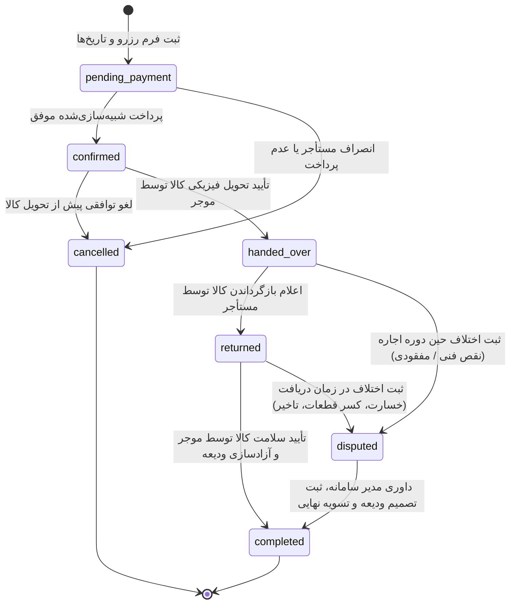
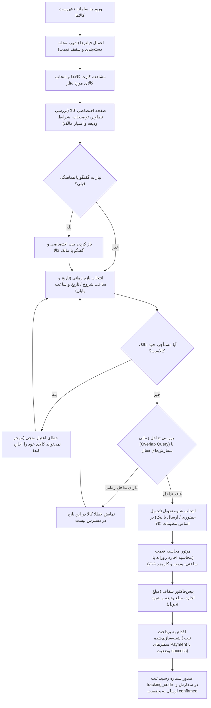
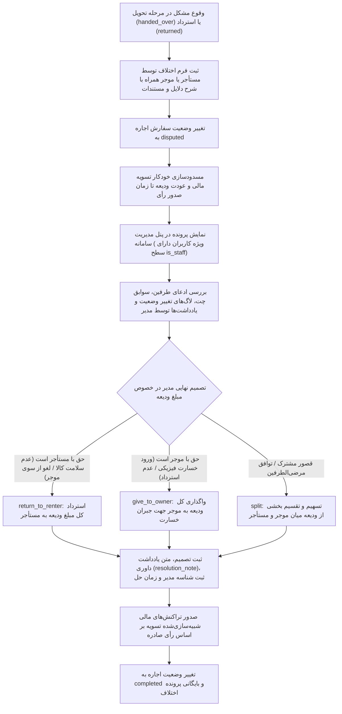
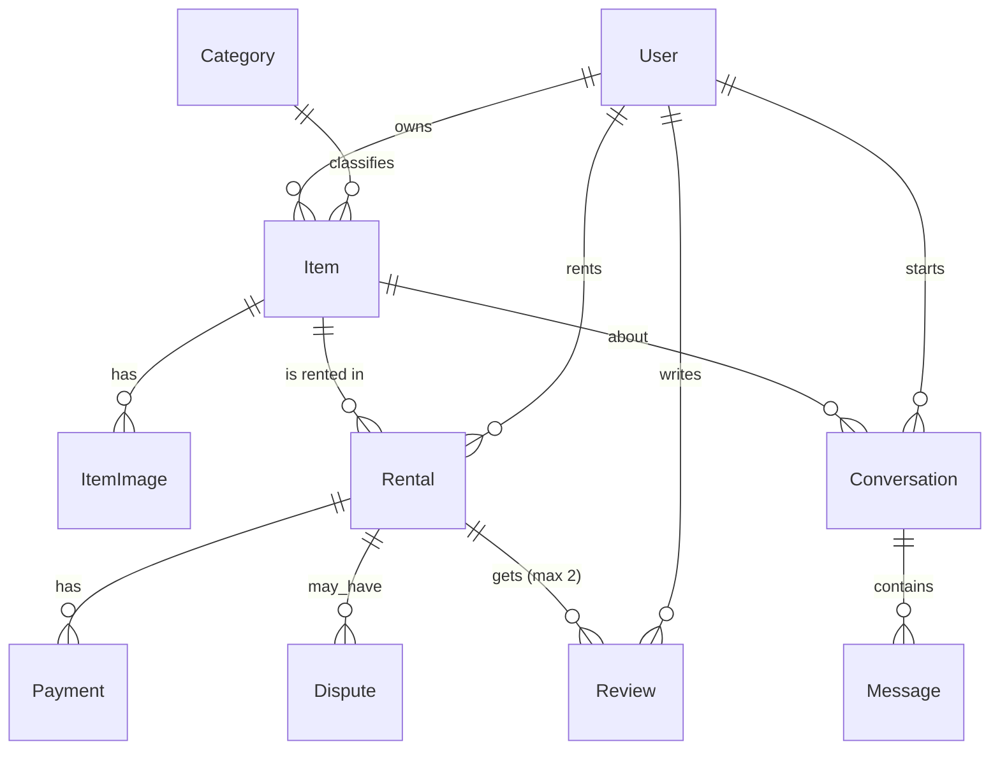

# گزارش پروژه — امانت‌یاب (درس برنامه‌نویسی وب)
نویسنده: امیر بازرگانی  |  استاد: سرکار خانم مهندس سلطانی  |  ترم: پاییز ۱۴۰۳

## ۱. نمودار فرآیندهای وب‌سایت
در سامانه «امانت‌یاب»، جریان کاربری، مدیریت وضعیت معاملات، فرآیند جستجو و رزرو، و حل اختلاف به صورت ماژولار و ساختاریافته طراحی شده‌اند. این فرآیندها در قالب ۴ نمودار استاندارد Mermaid مستند گردیده‌اند (جزئیات تکمیلی در سند `docs/PROCESSES.md` در دسترس است):

### ۱-۱. فرآیند کلی وب‌سایت (Whole Website Process)
این نمودار چرخه کامل تعامل کاربر مهمان و ثبت‌نام‌شده با سامانه، از جستجو یا ثبت کالا تا تحویل، پرداخت، ثبت نظر و داوری اختلافات را نشان می‌دهد:

```mermaid
flowchart TD
  Guest["بازدیدکننده / مهمان"] --> AuthCheck{"آیا حساب کاربری دارد؟"}
  AuthCheck -- "خیر" --> SignUp["ثبت‌نام کاربر (نام کاربری، ایمیل معتبر، رمز، شهر و محله)"]
  AuthCheck -- "بله" --> Login["ورود به حساب کاربری (نشست امن Django Session)"]
  SignUp --> Login
  
  Login --> Dashboard{"هدف کاربر چیست؟"}
  
  Dashboard -- "سپردن کالا (موجر)" --> ManageItems["مدیریت کالاهای من (ثبت، ویرایش، تصاویر، فعال/غیرفعال‌سازی)"]
  ManageItems --> CatalogLive["انتشار کالا در کاتالوگ محله"]
  
  Dashboard -- "اجاره کالا (مستأجر)" --> SearchCatalog["جستجو و فیلتر در کاتالوگ (دسته‌بندی، شهر، محله، قیمت)"]
  CatalogLive --> SearchCatalog
  
  SearchCatalog --> ItemDetail["مشاهده صفحه جزئیات کالا، تصاویر، ودیعه و امتیاز موجر"]
  ItemDetail --> ChatDecision{"نیاز به پرسش یا هماهنگی با موجر؟"}
  ChatDecision -- "بله" --> ChatSystem["ارسال پیام متنی در چت اختصاصی کالا"]
  ChatDecision -- "خیر" --> RentRequest["ثبت درخواست اجاره (انتخاب تاریخ شروع و پایان و نحوه تحویل)"]
  ChatSystem --> RentRequest
  
  RentRequest --> CostCalc["اعتبارسنجی تداخل زمانی و محاسبه هزینه اجاره، ودیعه و کارمزد"]
  CostCalc --> PaymentSim["پرداخت شبیه‌سازی‌شده (ثبت فاکتور در جدول Payment)"]
  PaymentSim --> RentalConfirmed["تأیید اجاره و صدور کد رهگیری یکتا (وضعیت: confirmed)"]
  
  RentalConfirmed --> Handover["تحویل فیزیکی کالا (حضوری / پیک) و تأیید موجر (وضعیت: handed_over)"]
  Handover --> InUse["استفاده در بازه زمانی توافق‌شده"]
  InUse --> ReturnItem["بازگرداندن کالا توسط مستأجر (وضعیت: returned)"]
  
  ReturnItem --> Inspection{"آیا کالا بدون آسیب و بموقع بازگشت؟"}
  Inspection -- "بله (تأیید سلامت کالا توسط موجر)" --> RentalCompleted["تکمیل فرآیند و آزادسازی ودیعه (وضعیت: completed)"]
  RentalCompleted --> TwoWayReview["ثبت امتیاز و دیدگاه دوطرفه (موجر و مستأجر نسبت به یکدیگر)"]
  
  InUse -. "بروز نقص، مفقودی یا عدم تحویل" .-> DisputeFlow["ثبت اختلاف توسط یکی از طرفین (وضعیت: disputed)"]
  Inspection -- "خیر (خسارت یا تاخیر)" --> DisputeFlow
  DisputeFlow --> AdminResolve["رسیدگی مدیر سامانه (is_staff)، تعیین وضعیت ودیعه و مختومه کردن"]
  AdminResolve --> RentalCompleted
```

### ۱-۲. ماشین وضعیت اجاره (Rental State Machine)
توالی و گذار وضعیت‌های هر سفارش اجاره در سامانه، به همراه نقاط انصراف و داوری، در نمودار حالت زیر مشخص شده است:

### ۱-۳. فرآیند جستجو تا ثبت و پرداخت اجاره (Search to Rent Flow)
مراحل یافتن کالا، بررسی شرایط دسترسی بدون تداخل با سایر رزروها، شیوه تحویل، برآورد هزینه و پرداخت:

### ۱-۴. فرآیند داوری و حل اختلاف (Dispute Resolution Flow)
نحوه مدیریت ادعاها، توقف تسویه مالی و تصمیم‌گیری مدیر در خصوص وجه امانی ودیعه:

---

## ۲. توضیح فرآیندها به تفکیک وب‌سایت و اپلیکیشن

### کل وب‌سایت
سامانه «امانت‌یاب» به عنوان یک پلتفرم اشتراک‌گذاری همتابه‌همتا (Peer-to-Peer) در مقیاس محله‌ای طراحی شده است تا امکان امانت‌سپاری و اجاره انواع ابزارآلات، تجهیزات، و لوازم خانگی را میان همسایگان فراهم آورد. در این پلتفرم، هر کاربر پس از ثبت‌نام می‌تواند به طور همزمان در هر دو نقش «موجر» (صاحب کالا) و «مستأجر» (امانت‌گیرنده) فعالیت نماید. جریان عملیاتی کل وب‌سایت با محوریت دسترسی سریع محلی، بهینه‌سازی هزینه‌ها و ایجاد اعتماد متقابل از طریق سیستم امانی وجه ضمانت (ودیعه)، بازخورد دوطرفه، و ارتباط مستقیم درون‌برنامه‌ای شکل گرفته است. هسته سیستم با تفکیک دقیق دامنه‌ها به ۶ اپلیکیشن مستقل جنگو سازمان‌دهی شده که هماهنگی میان آن‌ها، چرخه شفافی از کشف کالا تا تحویل، استرداد، و تسویه مالی امن را تضمین می‌کند.

### accounts
اپلیکیشن `accounts` مسئولیت چرخه حیات کاربران، هویت‌سنجی و مدیریت اطلاعات هویتی و سکونتی را بر عهده دارد. فرآیند این اپلیکیشن با ثبت‌نام کاربر از طریق فیلدهای نام کاربری یکتا، پست الکترونیکی معتبر و رمز عبور رمزنگاری‌شده آغاز می‌شود. کاربر در پروفایل خود مشخصات مهمی چون شماره تلفن، شهر، محله، و متن معرفی کوتاه (بیوگرافی) را تعیین می‌نماید که ستون فقرات فیلترهای محلی سامانه به شمار می‌رود. طبق اصل سادگی و استاندارد پروژه، نقش‌ها تفکیک پیچیده ندارند؛ تمام کاربران با یک مدل یکپارچه `User` فعالیت می‌کنند و تنها مدیران سامانه از طریق صفت `is_staff = True` متمایز می‌گردند. نشست‌ها با مکانیزم استاندارد کوکی و سشن جنگو امن‌سازی شده و فرآیند خروج و ویرایش مشخصات فردی به سادگی قابل مدیریت است.

### catalog
اپلیکیشن `catalog` ستون ویترین کالاها و مدیریت آگهی‌های امانی است. فرآیندها در این اپ شامل دو بخش عمومی و مدیریتی است: در بخش عمومی، ساختار درختی دسته‌بندی‌ها (`Category`) امکان مرور چندسطحی کالاها را فراهم می‌سازد؛ کاربران می‌توانند با استفاده از فیلترهای شهری، محله‌ای، بازه قیمت، و نام دسته‌بندی به جستجوی ابزارهای مورد نیاز بپردازند. در بخش اختصاصی مالکان، کاربر موجر می‌تواند کالای خود (`Item`) را با مشخصاتی نظیر وضعیت کیفی (نو، در حد نو، خوب، کارکرده)، نرخ اجاره روزانه و ساعتی، مبلغ ودیعه، و روش‌های مجاز تحویل (حضوری یا پیک) تعریف کند. همچنین مدیریت چندین تصویر به ازای هر کالا با تعیین یک تصویر اصلی (`is_primary`) در مدل `ItemImage` پشتیبانی می‌شود و موجر می‌تواند با فلگ `is_active` آگهی خود را بدون حذف فیزیکی، به طور موقت تعلیق یا مجدداً فعال نماید.

### rentals
اپلیکیشن `rentals` هسته اصلی منطق تراکنشی و حقوقی سامانه امانت‌یاب است. فرآیند رزرو با انتخاب تاریخ شروع و پایان و تعیین شیوه تحویل آغاز می‌شود. در گام نخست، سیستم با اعتبارسنجی جامع در سطح متد `clean()`، عدم تعلق کالا به خود کاربر متقاضی و همچنین عدم تداخل بازه درخواستی با سایر سفارش‌های رزروشده فعال (Double-Booking Prevention) را به صورت سخت‌گیرانه بررسی می‌نماید. در گام بعد، موتور محاسبه قیمت، بر مبنای مدت‌زمان و نرخ‌های روزانه/ساعتی، هزینه خالص اجاره، مبلغ ودیعه، و کارمزد سامانه (۱۵٪) را محاسبه می‌کند. پس از تأیید پیش‌فاکتور، فرآیند پرداخت به شکل شبیه‌سازی‌شده (با ثبت رکوردهای `Payment`، شناسه رسید، و تخصیص کد رهگیری منحصربه‌فرد) اجرا می‌شود. پس از پرداخت، سفارش وارد چرخه کنترل وضعیت‌ها (`pending_payment` -> `confirmed` -> `handed_over` -> `returned` -> `completed`) می‌گردد. همچنین زیرفرآیند داوری و حل اختلاف (`Dispute`) در صورت بروز هرگونه مشکل یا خسارت، مبالغ را تا زمان رسیدگی مدیر سامانه مسدود نموده و عودت یا جبران خسارت از محل ودیعه را سامان می‌دهد.

### reviews
اپلیکیشن `reviews` وظیفه سنجش رضایت و اعتبارسنجی اجتماعی کاربران و کیفیت ابزارها را پوشش می‌دهد. فرآیند ثبت نظر تنها پس از خاتمه موفقیت‌آمیز چرخه اجاره (وضعیت `completed`) در دسترس قرار می‌گیرد. در این فرآیند، هر دو طرف معامله (موجر و مستأجر) می‌توانند یک بار و به طور متقابل به عملکرد طرف دیگر امتیاز (از ۱ تا ۵ ستاره با قید اعتبارسنجی `MinValueValidator` و `MaxValueValidator`) و نظر متنی بدهند. قید یکتایی مرکب `(rental, reviewer)` در لایه پایگاه داده مانع از هرگونه ثبت نظر تکراری یا دستکاری امتیازات می‌شود. برآیند این امتیازها در پروفایل عمومی کاربران و صفحه جزئیات کالاها نمایش داده شده و ضریب اعتماد محله‌ای را ارتقا می‌بخشد.

### chat
اپلیکیشن `chat` کانال ارتباطی مستقیم و محرمانه درون پلتفرم است که کاربران را از به‌اشتراک‌گذاری شماره تلفن یا ارتباط خارج از سامانه بی‌نیاز می‌سازد. فرآیند گفتگو منحصراً بر بستر یک کالای معین و میان متقاضی اجاره و مالک آن در قالب موجودیت `Conversation` تشکیل می‌شود؛ قید یکتایی مرکب `(item, renter)` تضمین می‌کند که به ازای هر متقاضی و کالا، تنها یک رشته گفتگوی مداوم شکل بگیرد. طرفین می‌توانند پیش از رزرو نهایی برای هماهنگی ساعت تحویل، تست سلامت دستگاه، یا لوازم جانبی پیام متنی (`Message`) ارسال نمایند. این بستر علاوه بر بهبود تجربه کاربری، به عنوان سابقه مستند ارتباطی در صورت بروز اختلافات در فرآیند داوری به کمک مدیران سامانه می‌آید.

### core
اپلیکیشن `core` به عنوان بستر مشترک فنی، شالوده زیرساختی تمامی بخش‌های پروژه را تأمین می‌کند. این اپلیکیشن فاقد مدل داده‌ای اختصاصی در پایگاه داده است و تمرکز آن بر ارائه زیرساخت‌های اشتراکی است: از جمله قالب اصلی وب‌سایت (`base.html`) با ساختار راست‌به‌چپ (RTL) و تایپوگرافی فارسی، میدل‌ورهای کاربردی نظیر میدل‌ور ثبت لاگ درخواست‌ها و زمان پاسخ‌دهی جهت نظارت بر کارایی سیستم، کانتکست پروسسورهای عمومی جهت ارسال داده‌های پایه به قالب‌ها، ابزارهای کمکی کار با کوکی‌ها و سشن‌ها، و کنترل‌کننده‌های صفحات خطای استاندارد (نظیر صفحات سفارشی خطای ۴۰۴ و ۵۰۰). وجود اپلیکیشن `core` تضمین می‌کند که کدهای زیرساختی در میان سایر اپلیکیشن‌ها تکرار نشده و اصول طراحی تمیز (DRY) در کل پروژه رعایت گردد.

---

## ۳. مدل‌ها و روابط بین آن‌ها

در سامانه «امانت‌یاب»، ساختار داده‌ها بر پایه اصول طراحی رابطه‌ای (Relational Database Design) و نرمال‌سازی مناسب جهت پلتفرم همتابه‌همتا پیاده‌سازی شده است. تمام مدل‌های سامانه از پایگاه داده قدرتمند PostgreSQL استفاده می‌کنند. مقادیر مالی با دقت صفر رقم اعشار و حداکثر ۱۲ رقم (`numeric(12, 0)`) مدل‌سازی شده‌اند و کلیه جداول دارای فیلد ره‌گیری زمانی درج (`created_at`) و در صورت نیاز آخرین به‌روزرسانی (`updated_at`) هستند.

### ۳-۱. نمودار موجودیت-رابطه (ER Diagram)

نمودار زیر پیوندها و ماهیت روابط (یک‌به‌چند و چندبه‌چند مفهومی) میان ۱۰ مدل اصلی سامانه را نمایش می‌دهد:

---

### ۳-۲. جداول مشخصات مدل‌ها به تفکیک اپلیکیشن

#### ۱. اپلیکیشن `accounts`

##### مدل `User`
مدل سفارشی کاربر که با ارث‌بری از `AbstractUser` توسعه یافته است. در سامانه نقش‌های صلب وجود ندارد و هر کاربر بر حسب کانتکست تراکنش می‌تواند موجر یا مستأجر باشد؛ کاربران دارای `is_staff=True` به عنوان مدیر سامانه در نظر گرفته می‌شوند.

| نام فیلد | نوع در جنگو | نوع در PostgreSQL | مشخصات و پیش‌فرض | توضیحات و قیود |
|---|---|---|---|---|
| `id` | `BigAutoField` | `bigint` | Primary Key, Auto-increment | شناسه یکتای کاربر در سیستم |
| `username` | `CharField(150)` | `varchar(150)` | `unique=True`, اجباری | نام کاربری یکتا برای احراز هویت |
| `first_name` | `CharField(150)` | `varchar(150)` | `blank=True` | نام کوچک کاربر |
| `last_name` | `CharField(150)` | `varchar(150)` | `blank=True` | نام خانوادگی کاربر |
| `email` | `EmailField(254)` | `varchar(254)` | `unique=True`, اجباری | پست الکترونیکی یکتا جهت اعتبارسنجی و بازیابی |
| `phone` | `CharField(20)` | `varchar(20)` | `blank=True` | شماره تماس کاربر برای هماهنگی |
| `city` | `CharField(100)` | `varchar(100)` | `blank=True` | شهر محل سکونت کاربر (پایه فیلتر محلی) |
| `neighborhood` | `CharField(100)` | `varchar(100)` | `blank=True` | محله سکونت کاربر (پایه تطبیق همسایگی) |
| `bio` | `TextField` | `text` | `blank=True` | بیوگرافی و توضیحات معرفی کاربر |
| `is_email_verified` | `BooleanField` | `boolean` | `default=False` | پرچم تأیید ایمیل از طریق لینک فعال‌سازی |
| `is_staff` | `BooleanField` | `boolean` | `default=False` | دسترسی مدیریتی (پنل داوری و نظارت) |
| `is_active` | `BooleanField` | `boolean` | `default=True` | وضعیت فعال بودن حساب کاربری |
| `is_superuser` | `BooleanField` | `boolean` | `default=False` | مدیر ارشد با تمام دسترسی‌های سیستم |
| `date_joined` | `DateTimeField` | `timestamp with time zone` | `default=timezone.now` | زمان پیوستن کاربر به سامانه |
| `last_login` | `DateTimeField` | `timestamp with time zone` | `null=True`, اختیاری | آخرین زمان ورود به حساب کاربری |

---

#### ۲. اپلیکیشن `catalog`

##### مدل `Category`
دسته‌بندی درختی و سلسله‌مراتبی کالاها برای ساختاردهی به ویترین کاتالوگ.

| نام فیلد | نوع در جنگو | نوع در PostgreSQL | مشخصات و پیش‌فرض | توضیحات و قیود |
|---|---|---|---|---|
| `id` | `BigAutoField` | `bigint` | Primary Key, Auto-increment | شناسه دسته‌بندی |
| `name` | `CharField(100)` | `varchar(100)` | اجباری | عنوان دسته‌بندی (مانند ابزار برقی) |
| `slug` | `SlugField(120)` | `varchar(120)` | `unique=True`, `allow_unicode=True` | شناسه متنی سئو و آدرس یکتا (پشتیبانی یونیکد فارسی) |
| `parent` | `ForeignKey('self')` | `bigint` | `null=True`, `blank=True`, `on_delete=CASCADE` | ارجاع به والد برای پشتیبانی از درخت تودرتو (`related_name="children"`) |
| `created_at` | `DateTimeField` | `timestamp with time zone` | `auto_now_add=True` | زمان ثبت دسته‌بندی در سیستم |

- **ترتیب پیش‌فرض (`ordering`):** بر اساس `["name"]`.

##### مدل `Item`
کالای قابل امانت‌سپاری که توسط موجر به اشتراک گذاشته می‌شود.

| نام فیلد | نوع در جنگو | نوع در PostgreSQL | مشخصات و پیش‌فرض | توضیحات و قیود |
|---|---|---|---|---|
| `id` | `BigAutoField` | `bigint` | Primary Key, Auto-increment | شناسه یکتای کالا |
| `owner` | `ForeignKey(User)` | `bigint` | `on_delete=CASCADE` | مالک کالا (کاربر موجر) (`related_name="items"`) |
| `category` | `ForeignKey(Category)` | `bigint` | `on_delete=PROTECT` | دسته‌بندی کالا (حفاظت‌شده در برابر حذف دسته‌بندی) |
| `title` | `CharField(200)` | `varchar(200)` | اجباری | عنوان آگهی کالا |
| `description` | `TextField` | `text` | اجباری | توضیحات کامل وضعیت کالا و شرایط استفاده |
| `brand` | `CharField(100)` | `varchar(100)` | `blank=True` | برند یا سازنده کالا |
| `condition` | `CharField(20)` | `varchar(20)` | Choices (`new`, `like_new`, `good`, `fair`) | وضعیت کیفی و سلامت دستگاه |
| `hourly_price` | `DecimalField(12, 0)` | `numeric(12, 0)` | `null=True`, `blank=True` | نرخ اجاره ساعتی (جهت اجاره‌های کمتر از ۲۴ ساعت) |
| `daily_price` | `DecimalField(12, 0)` | `numeric(12, 0)` | اجباری | نرخ اجاره روزانه (پایه محاسبات فاکتور) |
| `deposit_amount` | `DecimalField(12, 0)` | `numeric(12, 0)` | `default=0` | مبلغ ودیعه ضمانت امانت |
| `city` | `CharField(100)` | `varchar(100)` | اجباری | شهر استقرار کالا جهت فیلتر و جستجو |
| `neighborhood` | `CharField(100)` | `varchar(100)` | اجباری | محله کالا جهت محاسبه مسافت همسایگی |
| `allow_pickup` | `BooleanField` | `boolean` | `default=True` | امکان تحویل حضوری کالا |
| `allow_courier` | `BooleanField` | `boolean` | `default=False` | امکان ارسال با پیک |
| `is_active` | `BooleanField` | `boolean` | `default=True` | فعال/غیرفعال بودن نمایش آگهی در کاتالوگ |
| `created_at` | `DateTimeField` | `timestamp with time zone` | `auto_now_add=True` | تاریخ و زمان درج آگهی |
| `updated_at` | `DateTimeField` | `timestamp with time zone` | `auto_now=True` | آخرین زمان ویرایش کالا |

- **قیود پایگاه داده (`constraints`):**
  1. `item_daily_price_positive`: قید شرطی `daily_price > 0` (نرخ روزانه باید همواره مثبت باشد).
  2. `item_at_least_one_delivery_method`: قید شرطی `allow_pickup = True OR allow_courier = True` (حداقل یک روش تحویل باید مجاز باشد).
- **شاخص‌های مرکب (`indexes`):**
  1. `item_city_active_idx`: ایندکس ترکیبی روی فیلدهای `(city, is_active)` جهت تسریع جستجوهای پربسامد کاتالوگ.
- **ترتیب پیش‌فرض (`ordering`):** بر اساس `["-created_at"]` (جدیدترین کالاها در ابتدا).

##### مدل `ItemImage`
تصاویر گالری کالا به همراه تعیین تصویر پیش‌فرض (کاور).

| نام فیلد | نوع در جنگو | نوع در PostgreSQL | مشخصات و پیش‌فرض | توضیحات و قیود |
|---|---|---|---|---|
| `id` | `BigAutoField` | `bigint` | Primary Key, Auto-increment | شناسه تصویر |
| `item` | `ForeignKey(Item)` | `bigint` | `on_delete=CASCADE` | کالای مربوطه (`related_name="images"`) |
| `image` | `ImageField` | `varchar(100)` | `upload_to="items/%Y/%m/"` | مسیر ذخیره‌سازی تصویر کالا روی مدیا |
| `is_primary` | `BooleanField` | `boolean` | `default=False` | پرچم نشان‌دهنده تصویر اصلی کالا در کارت‌ها |
| `order` | `PositiveIntegerField` | `integer` | `default=0` | ترتیب نمایش تصاویر در گالری محصول |
| `created_at` | `DateTimeField` | `timestamp with time zone` | `auto_now_add=True` | زمان بارگذاری تصویر |

- **ترتیب پیش‌فرض (`ordering`):** بر اساس `["order", "id"]`.

---

#### ۳. اپلیکیشن `rentals`

##### مدل `Rental`
هسته سفارش اجاره که چرخه کامل حقوقی و مالی معامله میان موجر و مستأجر را ره‌گیری می‌کند.

| نام فیلد | نوع در جنگو | نوع در PostgreSQL | مشخصات و پیش‌فرض | توضیحات و قیود |
|---|---|---|---|---|
| `id` | `BigAutoField` | `bigint` | Primary Key, Auto-increment | شماره فاکتور/شناسه رزرو |
| `item` | `ForeignKey(Item)` | `bigint` | `on_delete=PROTECT` | کالای موضوع قرارداد اجاره (`related_name="rentals"`) |
| `renter` | `ForeignKey(User)` | `bigint` | `on_delete=PROTECT` | کاربر مستأجر (`related_name="rentals"`) |
| `start_at` | `DateTimeField` | `timestamp with time zone` | اجباری | تاریخ و ساعت آغاز دوره اجاره |
| `end_at` | `DateTimeField` | `timestamp with time zone` | اجباری | تاریخ و ساعت پایان دوره اجاره |
| `delivery_method` | `CharField(20)` | `varchar(20)` | Choices (`pickup`, `courier`), `default='pickup'` | روش تحویل توافق‌شده |
| `status` | `CharField(20)` | `varchar(20)` | Choices (`pending_payment`, `confirmed`, `handed_over`, `returned`, `completed`, `cancelled`, `disputed`) | وضعیت کنونی در ماشین وضعیت سفارش |
| `rent_amount` | `DecimalField(12, 0)` | `numeric(12, 0)` | اجباری | مبلغ کل هزینه اجاره محاسبه‌شده |
| `deposit_amount` | `DecimalField(12, 0)` | `numeric(12, 0)` | `default=0` | مبلغ ودیعه ضمانت سلامت کالا |
| `commission_rate` | `DecimalField(4, 2)` | `numeric(4, 2)` | `default=0.15` | درصد کارمزد پلتفرم (۱۵٪) |
| `commission_amount` | `DecimalField(12, 0)` | `numeric(12, 0)` | `default=0` | سهم درآمدی سامانه از محل اجاره |
| `owner_payout` | `DecimalField(12, 0)` | `numeric(12, 0)` | `default=0` | سهم خالص پرداختی به موجر (`rent_amount - commission_amount`) |
| `tracking_code` | `CharField(64)` | `varchar(64)` | `unique=True`, `null=True`, `blank=True` | کد رهگیری یکتا و رسمی صادرشده پس از پرداخت |
| `created_at` | `DateTimeField` | `timestamp with time zone` | `auto_now_add=True` | زمان ثبت درخواست اجاره |
| `updated_at` | `DateTimeField` | `timestamp with time zone` | `auto_now=True` | آخرین زمان تغییر وضعیت یا اطلاعات |

- **قیود پایگاه داده (`constraints`):**
  1. `rental_end_after_start`: قید دیتابیسی `end_at > start_at` (تاریخ پایان باید حتماً بعد از تاریخ شروع باشد).
- **قواعد اعتبارسنجی در سطح متد `clean()`:**
  1. بررسی مجدد تقدم زمانی `end_at > start_at`.
  2. بررسی عدم مالکیت: موجر کالا نمی‌تواند کالای متعلق به خود را اجاره کند (`renter != item.owner`).
  3. جلوگیری از تداخل زمانی (Double-Booking Prevention): بررسی بازه زمانی سفارش با سایر سفارش‌های فعال و غیرلغوشده همان کالا (`exclude(status='cancelled')`).
- **ترتیب پیش‌فرض (`ordering`):** بر اساس `["-created_at"]`.

##### مدل `Payment`
ثبت تراکنش‌های مالی شبیه‌سازی‌شده پیرامون هر قرارداد اجاره.

| نام فیلد | نوع در جنگو | نوع در PostgreSQL | مشخصات و پیش‌فرض | توضیحات و قیود |
|---|---|---|---|---|
| `id` | `BigAutoField` | `bigint` | Primary Key, Auto-increment | شناسه داخلی تراکنش |
| `rental` | `ForeignKey(Rental)` | `bigint` | `on_delete=CASCADE` | سفارش اجاره مربوطه (`related_name="payments"`) |
| `kind` | `CharField(20)` | `varchar(20)` | Choices (`rent`, `deposit`, `deposit_refund`, `payout`) | نوع تراکنش مالی |
| `amount` | `DecimalField(12, 0)` | `numeric(12, 0)` | اجباری | مبلغ تراکنش به ریال/تومان |
| `status` | `CharField(20)` | `varchar(20)` | Choices (`success`, `failed`), `default='success'` | نتیجه پردازش تراکنش |
| `receipt_no` | `CharField(64)` | `varchar(64)` | `unique=True` | شماره رسید یا پیگیری یکتای بانکی شبیه‌سازی‌شده |
| `created_at` | `DateTimeField` | `timestamp with time zone` | `auto_now_add=True` | تاریخ و زمان انجام تراکنش |

- **ترتیب پیش‌فرض (`ordering`):** بر اساس `["-created_at"]`.

##### مدل `Dispute`
پرونده‌های اختلاف و دعاوی حقوقی که در صورت بروز آسیب به کالا، تاخیر، یا تخلف تشکیل می‌شوند.

| نام فیلد | نوع در جنگو | نوع در PostgreSQL | مشخصات و پیش‌فرض | توضیحات و قیود |
|---|---|---|---|---|
| `id` | `BigAutoField` | `bigint` | Primary Key, Auto-increment | شماره پرونده اختلاف |
| `rental` | `ForeignKey(Rental)` | `bigint` | `on_delete=PROTECT` | سفارش اجاره مورد اختلاف (`related_name="disputes"`) |
| `opened_by` | `ForeignKey(User)` | `bigint` | `on_delete=PROTECT` | کاربری که شکایت را مطرح کرده است (`related_name="opened_disputes"`) |
| `reason` | `TextField` | `text` | اجباری | شرح کامل دلایل ادعا و مستندات اختلاف |
| `status` | `CharField(20)` | `varchar(20)` | Choices (`open`, `resolved`), `default='open'` | وضعیت جاری رسیدگی به اختلاف |
| `deposit_decision` | `CharField(20)` | `varchar(20)` | Choices (`return_to_renter`, `give_to_owner`, `split`), `blank=True` | رأی مدیر در خصوص ودیعه |
| `resolution_note` | `TextField` | `text` | `blank=True` | شرح و ادله تصمیم نهایی مدیر |
| `resolved_by` | `ForeignKey(User)` | `bigint` | `null=True`, `blank=True`, `on_delete=SET_NULL` | کاربری که داوری را انجام داده (مدیر با دسترسی `is_staff`) |
| `resolved_at` | `DateTimeField` | `timestamp with time zone` | `null=True`, `blank=True` | زمان صدور رأی و مختومه شدن پرونده |
| `created_at` | `DateTimeField` | `timestamp with time zone` | `auto_now_add=True` | تاریخ و زمان ثبت اختلاف |

- **ترتیب پیش‌فرض (`ordering`):** بر اساس `["-created_at"]`.

---

#### ۴. اپلیکیشن `reviews`

##### مدل `Review`
امتیاز و دیدگاه کیفی دوطرفه میان موجر و مستأجر در پایان دوره اجاره.

| نام فیلد | نوع در جنگو | نوع در PostgreSQL | مشخصات و پیش‌فرض | توضیحات و قیود |
|---|---|---|---|---|
| `id` | `BigAutoField` | `bigint` | Primary Key, Auto-increment | شناسه نظر |
| `rental` | `ForeignKey(Rental)` | `bigint` | `on_delete=CASCADE` | سفارش اجاره مربوطه (`related_name="reviews"`) |
| `reviewer` | `ForeignKey(User)` | `bigint` | `on_delete=CASCADE` | کاربر نظردهنده (`related_name="written_reviews"`) |
| `reviewee` | `ForeignKey(User)` | `bigint` | `on_delete=CASCADE` | کاربر مورد ارزیابی قرارگرفته (`related_name="received_reviews"`) |
| `reviewee_role` | `CharField(10)` | `varchar(10)` | Choices (`owner`, `renter`) | نقش کاربر ارزیابی‌شونده در آن معامله |
| `rating` | `PositiveSmallIntegerField` | `smallint` | اجباری (بازه ۱ تا ۵) | امتیاز داده‌شده |
| `comment` | `TextField` | `text` | `blank=True` | متن تشریحی دیدگاه کاربر |
| `created_at` | `DateTimeField` | `timestamp with time zone` | `auto_now_add=True` | زمان ثبت نظر |

- **قیود پایگاه داده (`constraints`):**
  1. `review_rating_range_1_to_5`: قید شرطی `rating >= 1 AND rating <= 5`.
  2. `unique_rental_reviewer_review`: قید یکتایی مرکب `UniqueConstraint(fields=["rental", "reviewer"])` جهت جلوگیری از ثبت بیش از یک نظر توسط هر طرف در یک سفارش.
- **قواعد اعتبارسنجی در سطح متد `clean()`:**
  1. امکان ثبت نظر تنها در وضعیت خاتمه‌یافته (`rental.status == 'completed'`) مجاز است.
  2. جلوگیری از ثبت نظر برای خود (`reviewer != reviewee`).
  3. اعتبارسنجی انطباق هویت: `reviewer` و `reviewee` باید حتماً موجر یا مستأجر همان سفارش اجاره باشند.
  4. انطباق نقش: اگر نظردهنده موجر است، ارزیابی‌شونده باید مستأجر باشد با نقش `renter`؛ و اگر نظردهنده مستأجر است، ارزیابی‌شونده باید مالک باشد با نقش `owner`.
- **ترتیب پیش‌فرض (`ordering`):** بر اساس `["-created_at"]`.

---

#### ۵. اپلیکیشن `chat`

##### مدل `Conversation`
رشته گفتگوی اختصاصی میان کاربر متقاضی اجاره و مالک کالا بر بستر یک آگهی معین.

| نام فیلد | نوع در جنگو | نوع در PostgreSQL | مشخصات و پیش‌فرض | توضیحات و قیود |
|---|---|---|---|---|
| `id` | `BigAutoField` | `bigint` | Primary Key, Auto-increment | شناسه گفتگو |
| `item` | `ForeignKey(Item)` | `bigint` | `on_delete=CASCADE` | کالای موضوع مکالمه (`related_name="conversations"`) |
| `renter` | `ForeignKey(User)` | `bigint` | `on_delete=CASCADE` | کاربر متقاضی که گفتگو را آغاز کرده (`related_name="conversations"`) |
| `created_at` | `DateTimeField` | `timestamp with time zone` | `auto_now_add=True` | زمان ایجاد رشته گفتگو |
| `updated_at` | `DateTimeField` | `timestamp with time zone` | `auto_now=True` | آخرین زمان ارسال پیام یا به‌روزرسانی |

- **پراپرتی پویا (`@property owner`):** مالک کالا مستقیماً از طریق `item.owner` بدون نیاز به افزونگی فیلد در دیتابیس در دسترس است.
- **قیود پایگاه داده (`constraints`):**
  1. `unique_item_renter_conversation`: قید یکتایی مرکب `(item, renter)` که تضمین می‌کند میان یک متقاضی و یک کالا تنها یک رشته گفتگو وجود دارد.
- **قواعد اعتبارسنجی در سطح متد `clean()`:**
  1. مالک کالا نمی‌تواند با خود رشته گفتگو ایجاد کند (`renter != item.owner`).
- **ترتیب پیش‌فرض (`ordering`):** بر اساس `["-updated_at"]` (گفتگوهای دارای پیام جدیدتر در ابتدا).

##### مدل `Message`
پیام‌های متنی مبادله‌شده درون هر رشته گفتگو.

| نام فیلد | نوع در جنگو | نوع در PostgreSQL | مشخصات و پیش‌فرض | توضیحات و قیود |
|---|---|---|---|---|
| `id` | `BigAutoField` | `bigint` | Primary Key, Auto-increment | شناسه پیام |
| `conversation` | `ForeignKey(Conversation)` | `bigint` | `on_delete=CASCADE` | گفتگوی مربوطه (`related_name="messages"`) |
| `sender` | `ForeignKey(User)` | `bigint` | `on_delete=CASCADE` | کاربر فرستنده پیام (`related_name="sent_messages"`) |
| `body` | `TextField` | `text` | اجباری | متن پیام ارسالی |
| `is_read` | `BooleanField` | `boolean` | `default=False` | پرچم نشان‌دهنده خوانده‌شدن پیام توسط طرف مقابل |
| `created_at` | `DateTimeField` | `timestamp with time zone` | `auto_now_add=True` | زمان دقیق ارسال پیام |

- **قواعد اعتبارسنجی در سطح متد `clean()`:**
  1. فرستنده پیام (`sender`) باید الزاماً یا مالک کالا یا متقاضی همان رشته گفتگو باشد (`sender in (item.owner, renter)`).
- **ترتیب پیش‌فرض (`ordering`):** بر اساس `["created_at"]` (نمایش به ترتیب توالی زمانی).

---

#### ۶. اپلیکیشن `core`
اپلیکیشن `core` یک اپلیکیشن زیرساختی و اشتراکی است و مطابق تصمیم معماری پروژه (و سند `docs/DOMAIN.md`) **فاقد هرگونه مدل پایگاه داده‌ای** می‌باشد. این اپ وظیفه نگهداری کدهای مشترک زیر را بر عهده دارد:
- قالب پایه وب‌سایت (`base.html`) با تایپوگرافی راست‌به‌چپ (RTL) و استایل‌های Tailwind.
- میدل‌ورهای عمومی، از جمله میدل‌ور لاگین زمان پاسخ‌دهی و ریکوئست‌ها (`RequestLoggingMiddleware`).
- کانتکست پروسسورهای سراسری جهت تزریق اطلاعات پایه به کلیه قالب‌ها.
- کنترل‌کننده‌های صفحات خطای استاندارد سامانه (خطاهای ۴۰۴ و ۵۰۰).

---

## ۴. Managerها و دلیل تعریف آن‌ها
| Manager/QuerySet | متد | کار | چرا تعریف شد |
|---|---|---|---|

## ۵. Viewهای تعریف‌شده
در ادامه کلیه ویوهای پیاده‌سازی‌شده در سامانه امانت‌یاب به تفکیک اپلیکیشن، به همراه آدرس اینترنتی، متدهای HTTP مجاز، سطح دسترسی و قالب‌های رندرشده درج شده است:

| اپلیکیشن | نام View | نام روت (URL Name) | آدرس (URL Pattern) | متدها | سطح دسترسی | قالب (Template) | شرح عملکرد |
|---|---|---|---|---|---|---|---|
| **core** | `home` | `home` | `/` | GET | عمومی (همه) | `core/home.html` | صفحه اصلی، نوار جستجو، دسته‌بندی‌ها و کالاهای فعال با فیلتر شهر |
| **accounts** | `signup_view` | `signup` | `/accounts/signup/` | GET, POST | فقط مهمان (ناشناس) | `accounts/signup.html` | ثبت‌نام کاربر جدید، اعتبارسنجی موبایل ایران و ارسال پیامک/ایمیل خوش‌آمد |
| **accounts** | `login_view` | `login` | `/accounts/login/` | GET, POST | فقط مهمان (ناشناس) | `accounts/login.html` | ورود با نام کاربری و رمز عبور؛ هدایت کاربر لاگین‌شده به خانه |
| **accounts** | `logout_view` | `logout` | `/accounts/logout/` | POST | لاگین‌شده (`@login_required`) | _ندارد (ریدایرکت به خانه)_ | خروج امن از نشست کاربری با اعتبارسنجی توکن CSRF |
| **accounts** | `profile_edit_view` | `profile` | `/accounts/profile/` | GET, POST | لاگین‌شده (`@login_required`) | `accounts/profile.html` | مشاهده و ویرایش مشخصات فردی، شهر، محله، شماره تماس و بیوگرافی |
| **accounts** | `public_profile_view` | `public_profile` | `/accounts/users/<username>/` | GET | عمومی (همه) | `accounts/public_profile.html` | نمایش پروفایل عمومی کاربر، میانگین امتیاز، نظرات و کالاهای فعال او |
| **catalog** | `item_list` | `item_list` | `/catalog/` | GET | عمومی (همه) | `catalog/item_list.html` | مرور و جستجوی کالاها با فیلتر دسته‌بندی، کلیدواژه، شهر و نقشه توزیع |
| **catalog** | `item_detail` | `item_detail` | `/catalog/<int:pk>/` | GET | عمومی (همه) | `catalog/item_detail.html` | جزئیات کالا، گالری تصاویر، قیمت، ودیعه، نقشه موقعیت تقریبی و نظرات |
| **catalog** | `item_create` | `item_create` | `/catalog/new/` | GET, POST | لاگین‌شده (`@login_required`) | `catalog/item_form.html` | ثبت کالای جدید، بارگذاری تصاویر، تعیین قیمت، نشانی و موقعیت روی نقشه |
| **catalog** | `item_edit` | `item_edit` | `/catalog/<int:pk>/edit/` | GET, POST | فقط مالک کالا (`Item.owner`) | `catalog/item_form.html` | ویرایش مشخصات کالا، تصاویر، ودیعه و موقعیت جغرافیایی توسط مالک |
| **catalog** | `my_items` | `my_items` | `/catalog/my-items/` | GET | لاگین‌شده (`@login_required`) | `catalog/my_items.html` | داشبورد کالاهای من جهت مدیریت، ویرایش، حذف و تغییر وضعیت فعال/غیرفعال |
| **catalog** | `item_toggle_active` | `item_toggle_active` | `/catalog/<int:pk>/toggle-active/` | POST | فقط مالک کالا (`Item.owner`) | _ندارد (ریدایرکت به my_items)_ | فعال یا غیرفعال‌سازی سریع کالا جهت پنهان‌سازی از کاتالوگ عمومی |
| **catalog** | `item_delete` | `item_delete` | `/catalog/<int:pk>/delete/` | POST | فقط مالک کالا (`Item.owner`) | _ندارد (ریدایرکت به my_items)_ | حذف کالا از سامانه مشروط به عدم وجود سابقه اجاره فعال |
| **rentals** | `rental_request` | `rental_request` | `/rentals/request/<int:item_id>/` | GET, POST | لاگین‌شده (به جز مالک کالا) | `rentals/rental_request.html` | ثبت درخواست اجاره کالا با انتخاب بازه تاریخ، شیوه تحویل و آدرس/مختصات |
| **rentals** | `my_rentals` | `my_rentals` | `/rentals/my-rentals/` | GET | لاگین‌شده (`@login_required`) | `rentals/my_rentals.html` | فهرست سفارش‌های اجاره کاربر به عنوان مستأجر با فیلتر وضعیت |
| **rentals** | `owner_rentals` | `owner_rentals` | `/rentals/owner-rentals/` | GET | لاگین‌شده (`@login_required`) | `rentals/owner_rentals.html` | فهرست درخواست‌های اجاره دریافتی کالاها به عنوان موجر |
| **rentals** | `rental_pay` | `rental_pay` | `/rentals/<int:pk>/pay/` | GET, POST | فقط مستأجر سفارش (`renter`) | `rentals/rental_pay.html` | درگاه پرداخت شبیه‌سازی‌شده جهت پرداخت وجه اجاره و ودیعه |
| **rentals** | `rental_receipt` | `rental_receipt` | `/rentals/<int:pk>/receipt/` | GET | طرفین سفارش یا مدیر سیستم | `rentals/rental_receipt.html` | رسید پرداخت و جزئیات مالی سفارش، کارمزد و اطلاعات ودیعه |
| **rentals** | `rental_detail` | `rental_detail` | `/rentals/<int:pk>/` | GET | طرفین سفارش یا مدیر سیستم | `rentals/rental_detail.html` | جزئیات سفارش اجاره، تایم‌لاین مراحل، نقشه تحویل و دکمه‌های عملیاتی |
| **rentals** | `handover` | `handover` | `/rentals/<int:pk>/handover/` | POST | فقط مالک کالا در `confirmed` | _ندارد (ریدایرکت به جزئیات)_ | ثبت تحویل فیزیکی کالا به مستأجر و انتقال به وضعیت `handed_over` |
| **rentals** | `mark_returned` | `mark_returned` | `/rentals/<int:pk>/return/` | POST | فقط مستأجر در `handed_over` | _ندارد (ریدایرکت به جزئیات)_ | اعلام بازگرداندن کالا توسط مستأجر و انتقال به وضعیت `returned` |
| **rentals** | `confirm_return` | `confirm_return` | `/rentals/<int:pk>/confirm-return/` | POST | فقط مالک کالا در `returned` | _ندارد (ریدایرکت به جزئیات)_ | تایید دریافت کالا، استرداد ودیعه، تسویه با موجر و پایان اجاره (`completed`) |
| **rentals** | `cancel` | `cancel` | `/rentals/<int:pk>/cancel/` | POST | طرفین سفارش (طبق قواعد لغو) | _ندارد (ریدایرکت به جزئیات)_ | لغو سفارش اجاره و استرداد مبالغ پرداختی قبل از تحویل کالا |
| **rentals** | `dispute_open` | `dispute_open` | `/rentals/<int:pk>/dispute/` | GET, POST | طرفین در `handed_over`/`returned` | `rentals/dispute_form.html` | ثبت ادعای خسارت/اختلاف و تعلیق تسویه‌حساب‌ها (`disputed`) |
| **rentals** | `admin_dashboard` | `admin_dashboard` | `/rentals/dashboard/` | GET | فقط مدیر سامانه (`is_staff`) | `rentals/admin_dashboard.html` | داشبورد آماری مدیر: شمارش کاربران، کالاها، وضعیت اجاره‌ها و درآمد کارمزد |
| **rentals** | `admin_dispute_list` | `admin_dispute_list` | `/rentals/disputes/` | GET | فقط مدیر سامانه (`is_staff`) | `rentals/admin_dispute_list.html` | فهرست پرونده‌های اختلاف با امکان فیلتر بر اساس پرونده‌های باز یا حل‌شده |
| **rentals** | `admin_dispute_resolve` | `admin_dispute_resolve` | `/rentals/disputes/<int:pk>/resolve/` | GET, POST | فقط مدیر سامانه (`is_staff`) | `rentals/admin_dispute_resolve.html` | داوری اختلاف، صدور رای سه‌گانه، تعیین تکلیف ودیعه و تسویه اتمیک مالی |
| **reviews** | `review_create` | `review_create` | `/reviews/rentals/<int:rental_pk>/new/` | GET, POST | طرفین سفارش در `completed` | `reviews/review_form.html` | ثبت امتیاز ۱ تا ۵ ستاره و بازخورد متنی برای طرف مقابل یا کالای اجاره‌شده |
| **chat** | `inbox` | `inbox` | `/chat/` | GET | لاگین‌شده (`@login_required`) | `chat/inbox.html` | صندوق پیام‌ها و فهرست گفتگوهای کالا-محور کاربر با نشانگر پیام‌های ناخوانده |
| **chat** | `start_conversation` | `start_conversation` | `/chat/items/<int:item_pk>/start/` | GET | لاگین‌شده (به جز مالک کالا) | _ندارد (ریدایرکت به صفحه چت)_ | شروع یا بازیابی گفتگوی امن پیرامون یک کالای مشخص |
| **chat** | `conversation_detail` | `conversation_detail` | `/chat/<int:pk>/` | GET, POST | فقط طرفین گفت‌وگو | `chat/conversation_detail.html` | صفحه گفتگوی تعاملی کالا-محور، ارسال پیام و علامت‌گذاری پیام‌های خوانده‌شده |

## ۶. نکات تکمیلی (Session/Cookie، Logging، تأیید ایمیل، تست‌ها)
